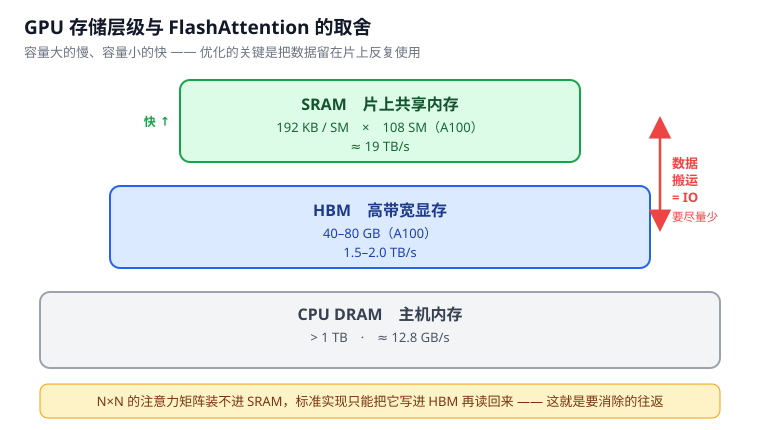
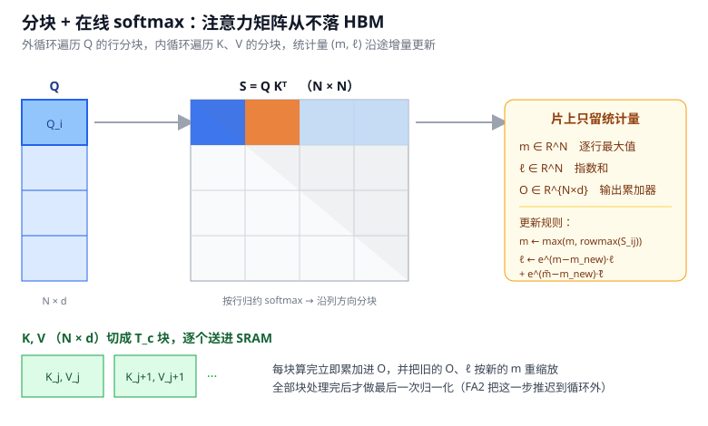
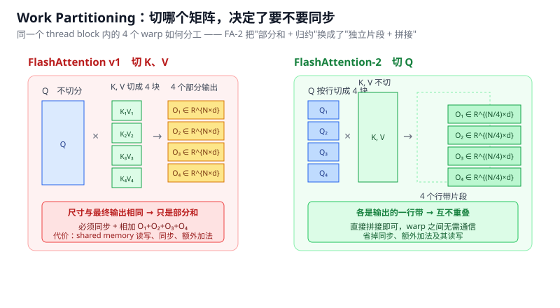

# FlashAttention v1 / v2 学习笔记

> 从原始论文出发整理：FlashAttention（arXiv:2205.14135）、FlashAttention-2（arXiv:2307.08691）、
> Self-attention Does Not Need O(n²) Memory（arXiv:2112.05682）。
> 全部推导、伪代码与复杂度结论均以论文正文为准，文末给出引用。

---

## 目录

- [0. 记号约定](#0-记号约定)
- [1. 问题的根源：算术强度与 IO](#1-问题的根源算术强度与-io)
- [2. 在线 softmax：把归一化拆到分块上](#2-在线-softmax把归一化拆到分块上)
- [3. FlashAttention v1](#3-flashattention-v1)
- [4. FlashAttention-2](#4-flashattention-2)
- [5. 另一种思路：EMA](#5-另一种思路ema)
- [6. 什么时候该用 FlashAttention](#6-什么时候该用-flashattention)
- [附录 A. 一张纸速查](#附录-a-一张纸速查)
- [附录 B. 自测题](#附录-b-自测题)
- [附录 C. 参考文献](#附录-c-参考文献)

---

## 0. 记号约定

| 符号 | 含义 |
| --- | --- |
| $N$ | 序列长度 |
| $d$ | 单头维度（head dimension），典型 64 / 128 |
| $\mathbf{Q},\mathbf{K},\mathbf{V}\in\mathbb{R}^{N\times d}$ | query / key / value 矩阵 |
| $\mathbf{S}=\mathbf{Q}\mathbf{K}^\top\in\mathbb{R}^{N\times N}$ | attention score 矩阵 |
| $\mathbf{P}=\mathrm{softmax}(\mathbf{S})\in\mathbb{R}^{N\times N}$ | 逐行 softmax 后的权重矩阵 |
| $\mathbf{O}=\mathbf{P}\mathbf{V}\in\mathbb{R}^{N\times d}$ | 输出 |
| $B_r,B_c$ | 行分块大小、列分块大小 |
| $T_r=\lceil N/B_r\rceil,\ T_c=\lceil N/B_c\rceil$ | 分块个数 |
| $M$ | 片上 SRAM 容量（A100 每 SM 192 KB） |
| HBM | High Bandwidth Memory，显存；A100 40–80 GB，1.5–2.0 TB/s |
| SRAM | 片上共享内存；A100 每 SM 192 KB，约 19 TB/s |
| IO | HBM 与 SRAM 之间的读写次数（本文的优化目标） |

按论文惯例，为叙述清晰**省略 softmax 缩放因子** $1/\sqrt{d}$ 以及可选的 mask / dropout；它们不改变任何结论。

---

## 1. 问题的根源：算术强度与 IO

### 1.1 标准注意力做了什么

给定 HBM 中的 $\mathbf{Q},\mathbf{K},\mathbf{V}$，目标是算出 $\mathbf{O}$ 并写回 HBM：

```text
S = Q Kᵀ        ∈ R^{N×N}
P = softmax(S)  ∈ R^{N×N}      (逐行)
O = P V         ∈ R^{N×d}
```

标准实现（论文 Algorithm 0）分三步：

```text
1. 从 HBM 分块读 Q, K → 算 S = QKᵀ      → 把 S 写回 HBM
2. 从 HBM 读 S        → 算 P = softmax(S) → 把 P 写回 HBM
3. 从 HBM 读 P, V     → 算 O = PV        → 把 O 写回 HBM
4. 返回 O
```

**关键问题**：$\mathbf{S}$ 和 $\mathbf{P}$ 都是 $N\times N$ 的稠密矩阵，必须**物化（materialize）到 HBM**。当 $N\gg d$ 时（论文给的例子：GPT-2 训练中 $N=1024,\ d=64$），这两个矩阵的显存占用是 $O(N^2)$ 的，而且要在 HBM 上来回搬运三次。

更要命的是，实际耗时并不由 FLOPs 决定。原因在于 **arithmetic intensity（算术强度）**：每访问一字节内存所对应的算术运算次数。

| 类型 | 判定依据 | 典型算子 |
| --- | --- | --- |
| **Compute-bound** | 耗时由算术运算量决定，访存时间占比很小 | 大 inner dimension 的矩阵乘法；channel 数很多的卷积 |
| **Memory-bound** | 耗时由访存次数决定，计算时间占比很小 | 逐元素操作（激活、dropout）、归约操作（sum、softmax、batch norm、layer norm） |

softmax 是**归约操作**，属于 memory-bound。把 $N\times N$ 的矩阵搬到 HBM 再搬回来做归约，绝大部分时间花在搬运上。

> 论文在引言里点明了这件事的直接后果：大量近似注意力方法把注意力放在**降低 FLOPs** 上，但「FLOP 减少」跟「墙钟时间变快」并不相关，因为它们忽略了访存开销（IO）。这也解释了为什么很多线性复杂度的近似方法并没有带来实际的加速。

### 1.2 为什么"少算"不等于"快"



论文给的硬件背景（A100）：

```text
HBM : 40–80 GB , 1.5–2.0 TB/s
SRAM: 192 KB × 108 个 SM , ≈ 19 TB/s      ← 比 HBM 快一个数量级，但小好几个数量级
```

GPU 的执行模型是：一个 kernel 把输入从 HBM 读进寄存器和 SRAM，算完，把输出写回 HBM。于是：

- **SRAM 快得多但装不下整个注意力矩阵**——$N\times N$ 在 $N=4096$ 时就是 16M 个元素；
- **HBM 装得下但慢**——每一次多余的往返都是实打实的时间。

所以真正的杠杆是：**让数据尽量在 SRAM 里被反复使用，减少 HBM 往返次数**。论文把这个原则叫做 **IO-aware**（IO 感知）。

### 1.3 两条核心思路

FlashAttention 要同时满足两件事，才能真正避免把注意力矩阵写进 HBM：

1. **不做物化也能算 softmax 的归约**——因为 softmax 的分母依赖整行所有元素，看起来必须先看到整行才能归一化；
2. **反向传播不需要保存那个大矩阵**。

对应论文用的两个经典技术：

- **Tiling（分块）**：把输入切成块、多次遍历输入块，**增量地**完成 softmax 归约；
- **Recomputation（重算）**：前向只保存 softmax 的归一化统计量，反向在片上快速重算注意力矩阵——比重 HBM 读回来更快。论文把它看作 selective gradient checkpointing 的一种形式；区别在于传统 checkpointing 是拿速度换显存，而这里因为省下的 HBM 访问更多，**即使 FLOPs 增加了，反向仍然更快**。

---

## 2. 在线 softmax：把归一化拆到分块上

这一节是 FlashAttention 的数学核心，也是最值得自己推一遍的地方。



### 2.1 数值稳定的 softmax

对向量 $x\in\mathbb{R}^{B}$，为数值稳定，先减去该向量的最大值：

```text
m(x)   := max_i x_i
f(x)   := [ e^{x_1-m(x)}  …  e^{x_B-m(x)} ]
ℓ(x)   := Σ_i f(x)_i
softmax(x) := f(x) / ℓ(x)
```

注意这里 $m(x)$ 的作用纯粹是**数值安全**：论文明确说明，分解 softmax 时用 scaling，而减去行内最大值是为了数值稳定。因为 softmax 对平移不变（$e^{x_i-c}$ 的比值与 $c$ 无关），减去任何常数都不改变结果，减最大值只是让指数项不会上溢。

### 2.2 两个块的合并公式

设 $x = \begin{bmatrix}x^{(1)} \\ x^{(2)}\end{bmatrix}\in\mathbb{R}^{2B}$，其中 $x^{(1)},x^{(2)}\in\mathbb{R}^{B}$。论文给出：

```text
m(x) = max( m(x⁽¹⁾), m(x⁽²⁾) )

f(x) = [ e^{m(x⁽¹⁾)-m(x)} f(x⁽¹⁾) ,  e^{m(x⁽²⁾)-m(x)} f(x⁽²⁾) ]

ℓ(x) = e^{m(x⁽¹⁾)-m(x)} ℓ(x⁽¹⁾) + e^{m(x⁽²⁾)-m(x)} ℓ(x⁽²⁾)

softmax(x) = f(x) / ℓ(x)
```

这三个式子是整个算法的支点，值得逐项理解：

- **$m$ 就是取最大值**，天经地义；
- **$f$ 的重缩放**：$f(x^{(1)})$ 是用**它自己的**局部最大值 $m(x^{(1)})$ 算出来的指数项。要拼进全局的 $f(x)$，而全局用的是 $m(x)$，差值正好是 $m(x^{(1)})-m(x)$，所以乘一个 $e^{m(x^{(1)})-m(x)}$ 就能把尺度调过去；
- **$\ell$ 同理**：局部求和项要乘上同一个重缩放因子。注意这里出现了**两件"额外的事"**——乘法（重缩放）和加法（合并块），它们在 GPU 上都是非 matmul 操作，这正是 FlashAttention-2 要减少的对象（见 4.1）。

**结论**：只要沿途保留两个统计量 $m(x)$ 和 $\ell(x)$，softmax 就可以**一次一个块**地算出来。论文把这种聚合方式称为 algebraic aggregation。

> **直觉**：softmax 之所以看起来不能分块，只因为分母是全局求和。但"全局求和"是可以**增量维护**的——先算局部和，遇到新块时把旧和按尺度差缩放一下再加进来。于是归一化被推迟到最后一步，中间过程全在片上。

### 2.3 一个可以手算的验证

抽象公式容易看着对、实际用错。下面用 4 个元素、两个块（$B_c=2$）、$d=2$ 走一遍，$V$ 取单位阵所以第一块输出就是 $\tilde{\mathbf P}^{(1)}$。

```text
S  = [ 1  2 | 3  4 ]          V = [ 1 0 ]
                                  [ 0 1 ]
                                  [ 1 0 ]
                                  [ 0 1 ]
```

**精确解**：$\mathrm{softmax}([1,2,3,4]) = [0.0321,\ 0.0871,\ 0.2369,\ 0.6439]$，故

```text
O = P V = [ 0.2369, 0.6439 ]
```

**分块计算**：

```text
块 1:  S⁽¹⁾ = [1, 2]
       m⁽¹⁾  = 2
       ℓ⁽¹⁾  = e^{-1} + e^{0} = 0.36788 + 1 = 1.36788
       Õ⁽¹⁾  = e^{S⁽¹⁾-m⁽¹⁾} V⁽¹⁾ = 0.36788·[1,0] + 1·[0,1] = [0.36788, 1]

块 2:  S⁽²⁾ = [3, 4]
       m⁽²⁾  = max(m⁽¹⁾, rowmax(S⁽²⁾)) = max(2, 4) = 4
       ℓ⁽²⁾  = e^{m⁽¹⁾-m⁽²⁾} ℓ⁽¹⁾ + rowsum(e^{S⁽²⁾-m⁽²⁾})
             = e^{-2}·1.36788 + (e^{-1} + e^{0})
             = 0.18512 + 1.36788 = 1.55300
       Õ⁽²⁾  = e^{m⁽¹⁾-m⁽²⁾} Õ⁽¹⁾ + e^{S⁽²⁾-m⁽²⁾} V⁽²⁾
             = 0.13534·[0.36788, 1] + 0.36788·[1,0] + 1·[0,1]
             = [0.04979, 0.13534] + [0.36788, 0] + [0, 1]
             = [0.41767, 1.13534]

收尾:  O = diag(ℓ⁽²⁾)⁻¹ Õ⁽²⁾ = [0.41767/1.55300, 1.13534/1.55300]
                               = [0.26894, 0.73106]
```

对照精确值 $\mathbf{P}$ 的后两块：$0.2369+0.0321 = 0.2690$，$0.6439+0.0871 = 0.7310$ —— **完全吻合**（末位差异来自手算舍入）。

这个例子里有两点值得留意：

- 归一化（除以 $\ell^{(2)}$）被**推迟到最后一步**。这正是 FlashAttention-2 的做法；v1 会在每个块都除一次（见 4.1）；
- 重缩放是对**已有的累加器**施加一个纯标量因子 $e^{m^{(1)}-m^{(2)}}$——它必须是逐行独立的，因为每一行的 max 不同。

---

## 3. FlashAttention v1

### 3.1 算法

**输入**：HBM 中的 $\mathbf{Q},\mathbf{K},\mathbf{V}\in\mathbb{R}^{N\times d}$，片上 SRAM 容量 $M$。

**分块大小**（论文 Algorithm 1 line 1）：

```text
B_c = ⌈M / (4d)⌉
B_r = min( ⌈M / (4d)⌉ , d )
```

**初始化**（line 2）：在 HBM 中置

```text
O = (0)_{N×d} ,  ℓ = (0)_N ,  m = (-∞)_N
```

**主循环**（line 3–13）：

```text
把 Q 沿行切成 T_r = ⌈N/B_r⌉ 块 Q_1…Q_{T_r}，每块 B_r × d
把 K, V 沿行切成 T_c = ⌈N/B_c⌉ 块，每块 B_c × d
ℓ, m 同样切成 T_r 个子向量，每块 B_r

for i = 1 … T_r:                     # 外层遍历 Q 的分块
    从 HBM 载入 Q_i 到 SRAM
    for j = 1 … T_c:                 # 内层遍历 K, V 的分块
        从 HBM 载入 K_j, V_j 到 SRAM
        S_ij = Q_i K_jᵀ                    ∈ R^{B_r × B_c}      (line 9)
        m̃_ij = rowmax(S_ij)                ∈ R^{B_r}            (line 10)
        P̃_ij = exp(S_ij − m̃_ij)            ∈ R^{B_r × B_c}
        ℓ̃_ij = rowsum(P̃_ij)               ∈ R^{B_r}

        m_i^new = max(m_i, m̃_ij)                                 (line 11)
        ℓ_i^new = e^{m_i − m_i^new} ℓ_i + e^{m̃_ij − m_i^new} ℓ̃_ij

        O_i ← diag(ℓ_i^new)^{-1} (                                       (line 12)
                 diag(ℓ_i) e^{m_i − m_i^new} O_i
               + e^{m̃_ij − m_i^new} P̃_ij V_j )

        ℓ_i ← ℓ_i^new ,  m_i ← m_i^new                            (line 13)
返回 O
```

### 3.2 逐行理解

**line 3–4：分块与对应关系。** $\mathbf{Q}$ 按行切（每块 $B_r$ 行），$\mathbf{K},\mathbf{V}$ 也按行切（每块 $B_c$ 行）。$\mathbf{K}$ 按行切意味着 $S_{ij}=\mathbf{Q}_i\mathbf{K}_j^\top$ 覆盖的是 score 矩阵的**第 $i$ 个行带、第 $j$ 个列块**。$\ell,m$ 与 $\mathbf{O}$ 一样按行切成 $T_r$ 份，因为它们是**逐行**统计量（每行的 max 与归一化因子各自独立）。

**line 9–10：在当前块里做局部归约。** 注意这里**没有**用全局的 $m_i$，而是先算当前块的局部最大值 $m̃_{ij}$。这是分块能成立的前提——先局部归约，再合并。

**line 11：两个统计量各自的更新方式不同。**

- $m_i^{\text{new}}$ 是纯粹的取最大值；
- $\ell_i^{\text{new}}$ 则**不仅加了新块的贡献，还把旧的 $\ell_i$ 按尺度差缩放了**。缩放因子 $e^{m_i-m_i^{\text{new}}}$ 就是第 2.2 节那个 $e^{m(x^{(1)})-m(x)}$：旧的 $\ell_i$ 是用旧的（更小的）最大值算出来的，换成新的最大值要乘这个因子。

**line 12：把输出也一起重缩放。** 这是最容易看漏的一行。三个要点：

1. $\mathrm{diag}(\ell_i)e^{m_i-m_i^{\text{new}}}\mathbf{O}_i$ 是**对已有累加器的修正**——旧输出是用旧的归一化尺度攒起来的，现在尺度变了，必须按 $\ell_i e^{m_i-m_i^{\text{new}}}$ 缩放；
2. $e^{m̃_{ij}-m_i^{\text{new}}}\tilde{\mathbf{P}}_{ij}\mathbf{V}_j$ 是**当前块的新贡献**，同样按新尺度归一；
3. 最外层的 $\mathrm{diag}(\ell_i^{\text{new}})^{-1}$ 是**除以新的归一化因子**完成归一化。

**line 11 与 line 12 的顺序很关键**：line 12 用到了**旧的** $\ell_i$ 和**旧的** $m_i$（因为旧累加器需要按旧尺度折算），所以 line 13 的更新必须放在 line 12 之后。这就是为什么 $m_i^{\text{new}},\ell_i^{\text{new}}$ 要先用新名字暂存、不能就地覆盖。

**关于 $B_r,B_c$ 的选择**：line 1 的 $M/(4d)$ 里那个 4 对应的是片上需要同时容纳的四块数据（$\mathbf{Q}_i$、$\mathbf{K}_j$、$\mathbf{V}_j$、$\mathbf{O}_i$，尺寸都是 $B\times d$）。$B_r$ 额外被 $\min(\cdot,d)$ 截断，保证行分块不超过维度。$\ell,m$ 的尺寸是 $O(N)$，相对可忽略。

### 3.3 IO 复杂度

这是论文的核心理论结果。前向传播的 HBM 访问次数：

```text
FlashAttention:      Θ( N² d² M⁻¹ )
标准注意力:          Ω( N d + N² )
```

其中 $d$ 是 head dimension，$M$ 是 SRAM 大小。论文同时证明了**下界**：不存在精确注意力算法能在所有 SRAM 大小下渐进地改进 HBM 访问次数——也就是 FlashAttention 在 IO 意义下是**最优**的。

对比一下量级就能看出为什么这个替换值得：

- 标准注意力的主导项是 $N^2$——**与 $d$ 无关，与 $M$ 无关**；
- FlashAttention 的主导项是 $N^2d^2/M$——多了一个 $d^2/M$ 的因子。

因为 $M$（192 KB）远大于 $d^2$（比如 $d=64$ 时 $d^2=4096$ 个元素），这个因子实际上远小于 1。论文给出的实测是**最多减少 9×** 的 HBM 访问（Fig. 2）。这也解释了为什么 $d$ 很大时 FlashAttention 的优势会缩水——$d^2/M$ 在变大。

> **注意**：FlashAttention 的**时间复杂度**仍是 $O(N^2d)$（甚至因为重算略高），它优化的是 **IO 次数**。二者是不同维度的事：前者管"算多少"，后者管"搬多少"。在 memory-bound 的场景里，后者才是墙钟时间的主导项。

### 3.4 反向传播

反向需要 $\mathbf{S},\mathbf{P}$ 来算 $\mathbf{Q},\mathbf{K},\mathbf{V}$ 的梯度。标准实现把它们保存在 HBM 里（$O(N^2)$）。FlashAttention 的做法是**不保存，而是重算**：前向只留下输出 $\mathbf{O}$ 和 softmax 统计量 $(m,\ell)$，反向时当 $\mathbf{Q},\mathbf{K},\mathbf{V}$ 的分块已经在 SRAM 里，就地重算所需的 $S_{ij}$ 与 $P_{ij}$。

具体地，反向过程中重算 attention weight 用的是前向保存的 $(m_i,\ell_i)$：

```text
P_ij = exp(S_ij − m_i) / ℓ_i
```

代价是额外的 FLOPs，收益是：

- 显存从 $O(N^2)$ 降到**线性于序列长度**（具体地：只存 $O(N)$ 的统计量，而不再是 $N\times N$ 的矩阵）；
- 因为省下的 HBM 读回更多，**即使 FLOPs 增加，反向仍然更快**。

此外论文还用到两个省显存的技巧：保存输出 $\mathbf{O}$ 与统计量 $(m,\ell)$ 来重算 $\mathbf{S},\mathbf{P}$；以及保存前向 dropout 的**随机数生成器状态**、在反向重新生成 mask，从而不必存储整个 dropout mask。

### 3.5 Block-Sparse FlashAttention（近似变体）

论文把 FlashAttention 作为**基本组件**扩展到了块稀疏注意力：把注意力矩阵按块划分，只对部分块做计算，其余块直接跳过（对应被 mask 掉的区域），于是：

- IO 复杂度比 FlashAttention 改善**一个正比于稀疏率（sparsity ratio）的因子**；
- 实测比 FlashAttention 本身还快 **2–4×**，序列长度可扩展到 **64K**；
- 论文声称它比当时已知的所有近似注意力方法都快。

> ⚠️ **这是全文唯一的近似部分**。其余（v1 前向、反向，v2 全部改进）都是**精确**的——输出与标准注意力一致，没有任何质量损失。

### 3.6 实验结论

- **注意力算子层面**：相对 PyTorch 实现，在 GPT-2 上最高 **7.6×** 加速（因为完全不需要读写 $N\times N$ 矩阵）；在 128–2K 的常见序列长度上最高 3× 加速，并可扩展到 64K；
- **端到端训练**：BERT-large（seq 512）比 MLPerf 1.1 的训练速度记录快 **15%**；GPT-2（seq 1K）比 HuggingFace / Megatron-LM 基线快 **3×**；Long-Range Arena（seq 1K–4K）快 **2.4×**；
- **模型质量**：GPT-2 perplexity 改善 **0.7**；长文档分类提升 **6.4** 个点；首次让 Transformer 在 **Path-X**（seq 16K，61.4% 准确率）和 **Path-256**（seq 64K，63.1%）上取得优于随机的表现——而**仅仅是因为用上了更长的序列**。
- **显存**：反向省下 **10–20×**（取决于序列长度）。

---

## 4. FlashAttention-2

### 4.1 动机：非 matmul FLOPs 贵 16 倍

v1 已经比优化过的基线快 2–4×，但**远没有达到 GEMM 的效率**：前向只到理论峰值的 **30–50%**，反向更低，只有 **25–35%**（A100）。而优化良好的 GEMM 能到 80–90%。

论文通过 profiling 定位到原因：**thread block 之间、warp 之间的工作划分不优**，导致要么占用率（occupancy）低，要么产生多余的 shared memory 读写。

**这里有个重要的先验知识**：现代 GPU 有专门加速矩阵乘的单元（Tensor Core）。论文给出的 A100 数字是：

```text
FP16/BF16 matmul      : 312 TFLOPs/s   ← 理论峰值
非 matmul 的 FP32 运算 :  19.5 TFLOPs/s
比值                   : 312 / 19.5 = 16
```

也就是说，**一个非 matmul FLOP 的开销相当于 16 个 matmul FLOP**。虽然非 matmul 操作的 FLOPs 数量占比很小，但它们**耗时更长**。所以要维持高吞吐（比如峰值 50% 以上），必须把时间尽量花在 matmul 上，尽量砍掉非 matmul 操作。

基于这个认识，FA2 做了三件事（论文引言的编号）：

1. **改算法，减少非 matmul FLOPs**（4.2）；
2. **把并行的维度从 batch × head 扩展到序列长度方向**，即使单个 head 也能并行，以提高占用率（4.3）；
3. **在 thread block 内部按 warp 重新划分工作**，减少 shared memory 通信与读写（4.4）。

结果：相对 FlashAttention 约 **2×** 加速，A100 上前向达到理论峰值的 **50–73%**、反向 **63%**；端到端训练 GPT 类模型时达到 **225 TFLOPs/s per A100**（模型 FLOPs 利用率 72%）。

### 4.2 算法层面的两个改动

FA2 对在线 softmax 做了两处微调，都不改变输出。

**改动一：不要每步都重缩放输出。**

v1 的 line 12 在两个地方除以了 $\ell$：

```text
Õ⁽²⁾ = diag(ℓ⁽¹⁾/ℓ⁽²⁾)⁻¹ Õ⁽¹⁾  +  diag(ℓ⁽²⁾)⁻¹ e^{S⁽²⁾−m⁽²⁾} V⁽²⁾
        └──── 对旧累加器的重缩放 ────┘   └──── 对新块的归一化 ────┘
```

论文观察到：**没必要让两项都乘 $\mathrm{diag}(\ell^{(2)})^{-1}$**。可以直接维护一个**未归一化**的累加器 $\tilde{\mathbf{O}}^{(2)}$，把统计量 $\ell^{(2)}$ 留着，**只在循环结束时除一次**：

```text
Õ⁽²⁾ = diag(e^{m⁽¹⁾−m⁽²⁾})⁻¹ Õ⁽¹⁾  +  e^{S⁽²⁾−m⁽²⁾} V⁽²⁾
       = e^{s⁽¹⁾−m} V⁽¹⁾ + e^{s⁽²⁾−m} V⁽²⁾

O⁽²⁾ = diag(ℓ⁽²⁾)⁻¹ Õ⁽²⁾ = O          ← 循环结束后才归一化
```

这就是第 2.3 节手算例子里的做法。省下的是**每次迭代的除法**（以及 v1 中为配合它而做的 $\ell$ 更新里的乘法）。

> 可以这样记：v1 每一步都在维护"精确的滚动平均"，v2 改成"滚动求和、最后一次再除"。求和比求平均少一次除法，而除法在 GPU 上是慢操作。

**改动二：反向只保存 logsumexp。**

v1 反向需要 $(m^{(j)}, \ell^{(j)})$ **两个**向量。FA2 指出只需要保存一个：

```text
L⁽ʲ⁾ = m⁽ʲ⁾ + log( ℓ⁽ʲ⁾ )
```

于是反向重算权重变成（对比 3.4 的 v1 形式）：

```text
v1 :  P_ij = exp(S_ij − m_i) / ℓ_i
FA2:  P_ij = exp(S_ij − L_i)
```

**为什么能省**：由定义 $\exp(S_{ij}-L_i)=\exp(S_{ij}-m_i-\log\ell_i)=\exp(S_{ij}-m_i)/\ell_i$，两者数学上完全等价；但从存储和读取角度，v1 要保存并读回两个 $N$ 维向量，FA2 只用一个，**读取次数和显存占用都减半**。$L_i$ 就是 logsumexp。

顺带一提：FA2 反向的算法结构与 v1 相同（仍受益于 tiling 与重算），改变的是保存什么、怎么重算。论文也提到反向的**概念**比前向简单（没有 softmax 重缩放），但**实现**更复杂——因为反向要保持 5 个矩阵乘法在 SRAM 里，而前向只要 2 个。

### 4.3 并行策略

**GPU 执行模型的必要背景**（论文 §2.1）：

```text
threads  →  组织成 thread block  →  调度到 SM (streaming multiprocessor) 上运行
            每个 block 内，32 个 thread 组成一个 warp
            warp 内的 thread 可用 shuffle 指令通信，或协作做矩阵乘
            warp 之间通过 shared memory 通信
            A100 有 108 个 SM
```

**v1 的并行策略**：分布在 **batch × attention head** 两个维度上，**一个 thread block 处理一个 attention head**。当 $(\text{batch}\times\text{head})$ 足够大时，108 个 SM 都能被喂饱，吞吐量就高。

**v1 的致命问题**：序列变长以后，单卡上的 **batch size 通常变得很小**。此时可并行的 head 数远少于 SM 数量，大量 SM 闲置，吞吐量塌下来。这个问题在长上下文场景（正是最需要 FlashAttention 的场景）里格外严重。

**v2 的解法**：既然 batch×head 不够用，就到**序列长度方向**去找并行度。而这里正好有现成的：

- 回到在线 softmax，**注意力矩阵的每一行是独立归约的**——第 $i$ 行的输出 $\mathbf{O}_i$ 只依赖 $\mathbf{Q}_i$ 与全部 $\mathbf{K},\mathbf{V}$，与其它行毫无交互；
- 所以可以让不同的 thread block 分别处理**不同的行分块**（即不同的 $i$），彼此不需要通信。

于是 FA2 让**外层循环（遍历 $\mathbf{Q}$ 的分块）也参与并行**：并行维度变成 **batch × head × 序列行分块**。这直接提高了占用率，尤其在小 batch 的长序列场景下效果显著。

> 注意这里"行之间无交互"的性质其实是 **tiling 本身**提供的：分块计算之所以可行，就是因为行的归约是独立的、列方向的归约被在线 softmax 处理掉了。

### 4.4 Work Partitioning（warp 级的工作划分）

并行解决了 block 之间的调度问题，但**block 内部**多个 warp 怎么分工同样影响性能——因为 warp 之间只能通过 shared memory 通信，多绕一趟就多一次读写。



**v1 的做法**：把一个 thread block 里的 thread 分成 **4 个 warp**，把 $\mathbf{K}$ 和 $\mathbf{V}$ 按序列长度维度各切成 **4 块**，每个 warp 分一块；**$\mathbf{Q}$ 不切**。以 $K_1,V_1$ 为例：

```text
S₁ = Q K₁ᵀ        ∈ R^{N × (N/4)}
P₁ = softmax(S₁)  ∈ R^{N × (N/4)}
O₁ = P₁ V₁        ∈ R^{N × d}
```

关键在于：**每个分块算出的 $\mathbf{O}_1$ 尺寸与最终输出 $\mathbf{O}$ 一致**（都是 $N\times d$），但它们只是**部分和**。所以必须：

1. 每个 warp 各算一个部分输出；
2. 写入共享存储区；
3. **同步（sync）之后把 4 个部分结果相加**。

代价：warp 间需要通信与同步，还有额外的加法及其对应的 shared memory 读写——而同步和加法都是非 matmul 开销。

**v2 的做法**：反过来，**切 $\mathbf{Q}$ 而不切 $\mathbf{K},\mathbf{V}$**。把 $\mathbf{Q}$ 按行切成 4 块，每个 warp 拿一块：

```text
S₁ = Q₁ Kᵀ        ∈ R^{(N/4) × N}
P₁ = softmax(S₁)  ∈ R^{(N/4) × N}
O₁ = P₁ V         ∈ R^{(N/4) × d}
```

这时每个分块的输出 $\mathbf{O}_1$ 是最终输出的**一个行带**，彼此不重叠、没有求和关系：

- **warp 之间不需要通信、不需要同步**；
- **不需要额外的加法和相应的读写**；
- 每个 warp 的结果**直接拼接（concat）**就是最终输出。

这就是 FA2 的 work partitioning 比 v1 高效的原因：它把"部分和 + 归约"变成了"独立片段 + 拼接"。

> 两处改动合起来看，FA2 的主线非常一致：**凡是能在 matmul 之外省掉的（除法、同步、加法、多余的读写），就省掉**。这也解释了为什么它相对 v1 只快了约 2×，而相对标准实现能快 3–10×。

### 4.5 结果

| 指标 | FlashAttention v1 | FlashAttention-2 |
| --- | --- | --- |
| 前向吞吐（% 理论峰值，A100） | 30–50% | **50–73%** |
| 反向吞吐 | 25–35% | **63%** |
| 相对 v1 | 1× | **≈2×**（论文亦称 2–3×） |
| 端到端训练 | — | **225 TFLOPs/s per A100**（72% MFU） |
| 相对标准注意力 | 2–4× | **3–10×** |
| 反向保存的统计量 | $(m,\ell)$ 两个向量 | $L=\mathrm{logsumexp}$ 一个向量 |

---

## 5. 另一种思路：EMA

FlashAttention 与 EMA 常被并列提起，但它们**出发点不同**，值得分清。

### 5.1 问题：权重必须被保存

对单个 query $q$，注意力是

```text
s_i = ⟨q, k_i⟩ ,   o = ( Σ_i v_i e^{s_i} ) / ( Σ_j e^{s_j} )
```

标准实现要先算出并**保存整行权重** $s'_i=e^{s_i}$（每个 query 需要 $O(n)$ 时间与空间），而自注意力要处理所有 query，于是整体时间和空间都是 $O(n^2)$。

### 5.2 增量算法

关键观察：分子、分母都是**对 $i$ 从 1 累加到 $n$ 的求和项**，所以可以增量维护。状态只有两项——一个 $d$ 维向量 $v^\*$ 和一个标量 $s^\*$，都初始化为 0：

```text
每个 (k_i, v_i)：
    s_i = ⟨q, k_i⟩
    v* ← v* + v_i · e^{s_i}
    s* ← s* + e^{s_i}

全部处理完后：  o = v* / s*
```

自注意力就是对每个 query 顺序执行同一过程。**对单个 query，额外空间是 $O(1)$（与序列长度无关）**——这就是标题"不需要 $O(n^2)$ 内存"的由来。

### 5.3 数值稳定性：必须维护 running max

论文指出一个很实际的问题：**score 超过 89 就会在 float32 / bfloat16 里上溢成 inf**。所以和 FlashAttention 一样，要额外维护一个运行最大值 $m^\*$（初始化为 $-\infty$），两个累加器都要重缩放：

```text
每个 (k_i, v_i)：
    m_i = max(m*, s_i)
    v* ← v* · e^{m* − m_i} + v_i · e^{s_i − m_i}
    s* ← s* · e^{m* − m_i} + e^{s_i − m_i}
    m* ← m_i

最后：  o = v* / s*
```

对比一下就能看出这和 FlashAttention 的在线 softmax 是**同一套数学**：$e^{m^\* - m_i}$ 就是那个"把旧累加器按新的最大值重新缩放"的因子。论文也说明他们的方法是**精确的**（不是近似），并明确处理了数值稳定性问题。

> 实现细节：在 JAX 代码里，每个分块的最大值还会额外经过 `jax.lax.stop_gradient`，避免最大值这一项参与梯度（它本身是 max 操作，梯度没有意义）。

### 5.4 分块实现与 $O(\sqrt n)$

纯顺序累加虽然省内存，但硬件利用率差。论文的实际实现用**两层循环**做分块：

```text
外层：遍历 query 的分块（query_chunk_size 默认 1024，迭代次数线性）
内层：顺序遍历 key/value 的分块（key_chunk_size 默认 4096，与 num_kv 取 min）
      每个 (query 块, kv 块) 产出一个"局部摘要"：
          exp_weights = exp(S_chunk − max_score)      ← 局部最大值
          exp_values  = exp_weights @ V_chunk
          return (exp_values, rowsum(exp_weights), max_score)
合并：取所有分块最大值的全局 max → 各分块按 e^{chunk_max − global_max} 重缩放
      → 分别求和 → 最后 all_values / all_weights
```

**内存复杂度的层次**（这是最容易被误传的一点，论文给了三个不同的说法）：

| 范围 | 额外内存 |
| --- | --- |
| 单个 query，纯顺序 | $O(1)$ |
| 整个自注意力，纯顺序 | $O(\log n)$ —— 额外要存一个指向序列/query 列表的索引 |
| 实际分块实现（query 块固定、kv 块取 $\sqrt n$） | $O(\sqrt n)$ |

其中 $O(\log n)$ 的来源很具体：如果输入顺序和计算顺序不一致，就得额外保存一个**索引**，索引本身占 $O(\log n)$。理论最优是"query 块取常数、key/value 块取 $\sqrt n$"，于是得到 $\sqrt n$ 个摘要，对应 $O(\sqrt n)$ 内存。两个 chunk size 都作为参数暴露出来。

**时间复杂度不变**：单 query $O(n)$，整体 $O(n^2)$。也就是说 EMA 是**拿时间换空间**，而不是降低复杂度。

> 反向传播上，论文对分块摘要函数施加了 `jax.checkpoint`：前向不保留分块中间结果，反向重算——和 FlashAttention 的重算思路一致。

### 5.5 实测效果

在单块 TPUv3、单 attention head、输入 bfloat16 上（"内存开销"指超出输入/输出张量之外的峰值显存，OOM 表示超过 16 GB）：

**推理**

| 序列长度 $n$ | $2^{10}$ | $2^{12}$ | $2^{14}$ | $2^{16}$ | $2^{18}$ | $2^{20}$ |
| --- | --- | --- | --- | --- | --- | --- |
| 输入/输出 | 640 KB | 2.5 MB | 10 MB | 40 MB | 160 MB | 640 MB |
| 标准注意力开销 | 4.0 MB | 64 MB | **1 GB** | OOM | OOM | OOM |
| EMA 开销 | 4.0 MB | 16 MB | **17 MB** | 21 MB | 64 MB | 256 MB |
| 相对计算速度 | ±5% | −8% | **−13%** | — | — | — |

**求导（反向）**

| 序列长度 $n$ | $2^{10}$ | $2^{12}$ | $2^{14}$ | $2^{16}$ | $2^{18}$ | $2^{20}$ |
| --- | --- | --- | --- | --- | --- | --- |
| 标准注意力开销 | 8.0 MB | 128 MB | **2.0 GB** | OOM | OOM | OOM |
| EMA 开销 | 8.0 MB | 41 MB | **64 MB** | 257 MB | 1.0 GB | 4.0 GB |
| 相对计算速度 | ±5% | −30% | **−35%** | — | — | — |

要点：

- $n = 2^{14} = 16384$ 时，**推理内存从 1 GB 降到 17 MB（约 59×），求导内存从 2.0 GB 降到 64 MB（32×）**——与论文摘要给出的 59×/32× 一致；
- 代价是**计算变慢**：推理约 −13%，求导约 −30% ~ −35%；
- 标准注意力在 $2^{16}$ 就 OOM，而 EMA 能扩展到 $n=2^{20}$（约 100 万），论文声称至少可扩展到 $2^{20}$；
- 两种实现输出的最大绝对差为 $1.8\times10^{-7}$（$n=2^{14}$，标准正态输入），即**数值上等价**。

### 5.6 与 FlashAttention 的关系

| | EMA | FlashAttention |
| --- | --- | --- |
| 首要目标 | 降低**显存占用** | 降低 **HBM 访问（IO）** |
| 手段 | 增量累加 + 分块摘要，彻底消掉权重矩阵 | tiling + 在线 softmax + 重算 |
| 时间代价 | 增加（推理 ~13%，反向 30–35%） | **不增加**，反而显著加速 |
| 共同点 | 都维护运行统计量、最后统一归一化、反向都重算 | 同左 |

一句话：**两者共享同一套在线 softmax 数学，但优化目标不同**——EMA 用时间换显存，FlashAttention 用重算换 IO，且后者在 GPU 上同时拿到了速度和显存两个好处。

工程上还有个容易混淆的点：**xformers 里的 "Efficient Memory Attention" 并不特指 EMA**，而是指一系列对显存友好的注意力变体，**FlashAttention 也在其中，且优先级最高**；xformers 会根据输入自动选择实际算子。

---

## 6. 什么时候该用 FlashAttention

理解一个技术"什么时候不管用"和"什么时候管用"同样重要。

### 6.1 它优化的是什么

| | 标准注意力 | FlashAttention |
| --- | --- | --- |
| 时间复杂度（FLOPs） | $O(N^2 d)$ | $O(N^2 d)$（重算使其略高） |
| 空间复杂度 | $O(N^2)$ | $O(N)$（不物化 $\mathbf{S},\mathbf{P}$） |
| HBM 访问次数 | $\Omega(Nd + N^2)$ | $\Theta(N^2 d^2 M^{-1})$ |
| 输出精度 | 基准 | **完全一致**（非近似） |

一句话：**它不改时间复杂度，改的是访存**。所以它有效的前提是"这个算子确实被访存卡住"——而 softmax 这种归约操作正是如此。

### 6.2 优势会缩水的场景

- **$d$ 很大**：IO 优势因子是 $d^2/M$，$d$ 越大优势越小。这也是为什么工程实现里 head_dim 通常有上限（常见 ≈256）。
- **序列很短**：$N$ 小的时候 $N^2$ 本身不大，tiling 的固定开销（以及被截断的 $B_r$）占比上升，收益有限。
- **算力本身不是瓶颈的场景**（比如小模型 + 大 batch）：此时标准实现可能也已经吃满带宽。

### 6.3 实践提示

- 用 PyTorch 时通常不用手写，`F.scaled_dot_product_attention` 会根据条件自动选后端；能走到 flash 后端时性能与 FA2 相当。
- 触发 flash 后端的常见条件：dtype 为 fp16/bf16（而非 fp32）、较新的 GPU（Ampere sm80+ / Hopper）、head_dim 在支持范围内、mask 是 causal 或无 mask、**不要求返回注意力权重**、张量布局连续对齐。
- 会让它**掉回数学实现**从而明显变慢的情形：fp32 输入、要求输出注意力权重（`output_attentions=True`）、传入 flash 不支持的浮点加性 mask/bias、head_dim 超范围、老显卡或 CPU。
- 原因和前文一致：要求"返回注意力权重"等于强制**物化** $N\times N$ 矩阵——正是 FlashAttention 要避免的事。

---

## 附录 A. 一张纸速查

```text
【核心问题】
  S = QKᵀ, P = softmax(S), O = PV
  S、P 是 N×N，标准实现要物化到 HBM（O(N²) 显存 + 三次 HBM 往返）
  softmax 是 memory-bound，耗时由访存而非 FLOPs 决定

【核心技巧】
  1. tiling       : 分块，让数据在 SRAM 里被复用
  2. online softmax: 增量维护 (m, ℓ)，把归一化推迟到最后
  3. recomputation : 反向不存 S、P，用 (m,ℓ) 或 L 就地重算
  4. kernel fusion : 整个注意力融成一个 CUDA kernel

【在线 softmax 合并公式】
  m(x) = max(m(x⁽¹⁾), m(x⁽²⁾))
  ℓ(x) = e^{m(x⁽¹⁾)−m(x)} ℓ(x⁽¹⁾) + e^{m(x⁽²⁾)−m(x)} ℓ(x⁽²⁾)
  缩放因子 e^{m_local − m_global} 是全部推导的关键

【复杂度】
  HBM 访问:  Θ(N²d²/M)   vs 标准 Ω(Nd + N²)     最多省 9×
  显存     :  O(N)       vs 标准 O(N²)          省 10–20×
  FLOPs    :  仍 O(N²d)（重算略增）

【数字】
  A100: HBM 40–80GB @1.5–2.0TB/s ; SRAM 192KB/SM ×108 @≈19TB/s
  matmul 312 TFLOPs/s vs 非 matmul 19.5 TFLOPs/s  → 非 matmul 贵 16×
  v1 前向 30–50% 峰值，反向 25–35%
  v2 前向 50–73% 峰值，反向 63%，端到端 225 TFLOPs/s (72% MFU)
  相对标准注意力: v1 2–4×，v2 3–10×；v2 比 v1 快约 2×

【v1 → v2 三处改进】
  1. Algorithm  : 不每步重缩放输出（最后统一除）；反向只存 L = m + log ℓ
  2. Parallelism: 并行维度 batch×head → batch×head×行分块（提高占用率）
  3. Partition  : warp 切分 K,V（v1，需同步+求和）→ 切 Q（v2，直接拼接）

【EMA（Rabe & Staats, arXiv:2112.05682）】
  目标相反：省显存，代价是变慢（推理 ~13%，反向 30–35%）
  增量状态：v* ∈ R^d 与 s* ∈ R（+ running max m*）
    v* ← v*·e^{m*−m_i} + v_i·e^{s_i−m_i} ;  s* ← s*·e^{m*−m_i} + e^{s_i−m_i}
  内存：单 query 纯顺序 O(1)；整体 O(log n)；实际分块实现 O(√n)
  时间不变：O(n) / O(n²)
  n=16384 时：推理 1GB→17MB（59×），求导 2GB→64MB（32×）
```

---

## 附录 B. 自测题

**概念层**

1. 为什么"减少 FLOPs"不必然带来墙钟加速？什么量决定了 memory-bound 算子的耗时？
2. 用算术强度解释：为什么 softmax 是 memory-bound，而大 inner dimension 的矩阵乘是 compute-bound？
3. A100 上 matmul 与非 matmul 的理论吞吐差多少倍？这个比例对算法设计有什么直接指导？
4. HBM 与 SRAM 在容量和带宽上各差几个数量级？FlashAttention 用哪一层计算、哪一层存储？

**推导层**

5. 写出把两个块的 softmax 合并成一个的 $(m,\ell,f)$ 公式，并解释每个重缩放因子的来源。
6. 为什么 $\ell$ 的更新里要**乘**一个 $e^{m^{\text{old}}-m^{\text{new}}}$，而不是直接相加？
7. v1 的 line 12 为什么必须用**旧的** $\ell_i$ 和 $m_i$？为什么 line 13 必须放在 line 12 之后？
8. 自己取一个 4 元素向量，手算一遍分块在线 softmax，并验证与精确 softmax 一致。
9. FA2 为什么可以不在每次迭代里除以 $\ell$？用一个"滚动求和 vs 滚动平均"的类比解释。
10. 证明 $\exp(S_{ij}-L_i)$ 与 $\exp(S_{ij}-m_i)/\ell_i$ 等价，并说明 FA2 这样改省下了什么。
11. $B_c=\lceil M/(4d)\rceil$ 里的 4 对应哪四块数据？

**工程层**

12. v1 的并行策略在长上下文场景为什么会失效？v2 增加了哪个维度的并行、为什么这个维度可以并行？
13. v1 用 $K,V$ 做 warp 切分，为什么需要同步和额外加法？v2 改成切 $Q$ 后为什么不需要？
14. Block-Sparse FlashAttention 与 EMA 分别降低的是什么（HBM 访问还是显存占用）？哪个是近似算法、哪个是精确算法？
15. 为什么"要求返回注意力权重"会让 PyTorch 掉出 flash 后端？这和 FlashAttention 的设计目标有什么关系？
16. EMA 论文给出三个不同的内存复杂度（$O(1)$ / $O(\log n)$ / $O(\sqrt n)$），分别对应什么设定？$O(\log n)$ 里的 log 是从哪来的？

---

## 附录 C. 参考文献

1. Tri Dao, Daniel Y. Fu, Stefano Ermon, Atri Rudra, Christopher Ré.
   **FlashAttention: Fast and Memory-Efficient Exact Attention with IO-Awareness.**
   arXiv:2205.14135, 2022. <https://arxiv.org/abs/2205.14135>
2. Tri Dao.
   **FlashAttention-2: Faster Attention with Better Parallelism and Work Partitioning.**
   arXiv:2307.08691, 2023. <https://arxiv.org/abs/2307.08691>
3. Markus N. Rabe, Charles Staats.
   **Self-attention Does Not Need O(n²) Memory.**
   arXiv:2112.05682, 2021. <https://arxiv.org/abs/2112.05682>

**代码实现**

- FlashAttention v1: <https://github.com/HazyResearch/flash-attention>
- FlashAttention v2: <https://github.com/Dao-AILab/flash-attention>
- xformers（含 memory-efficient attention 系列算子）: <https://github.com/facebookresearch/xformers>

---

### 说明

本笔记基于上述公开论文整理，公式、伪代码、复杂度结论与实验数字均取自论文正文，引用见附录 C。
文中的手算验证示例（第 2.3 节）与总结性表格为整理者补充，用于自检与速查。
若发现与论文不一致之处，**以论文为准**。
