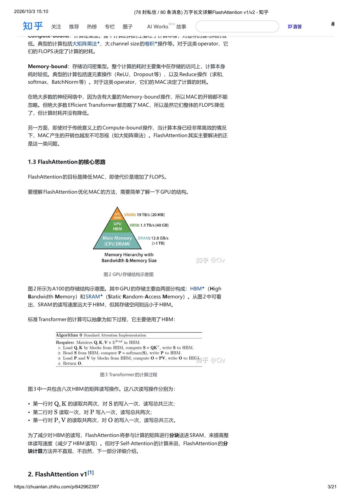
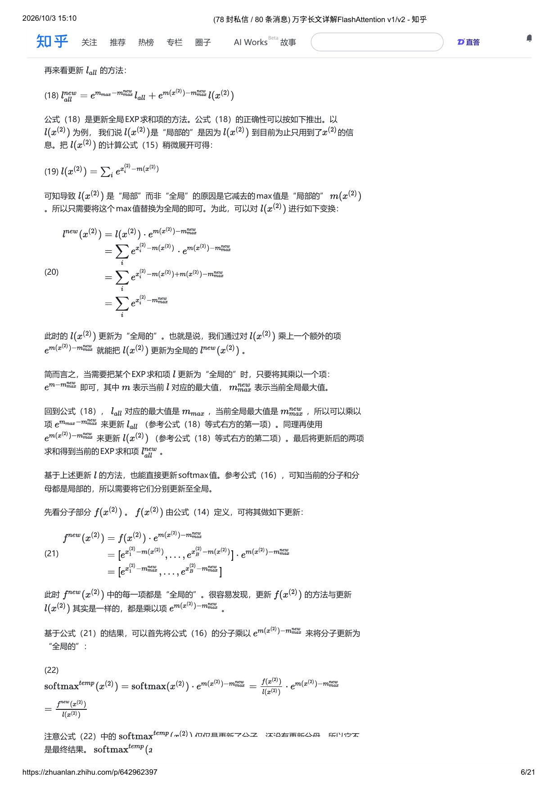
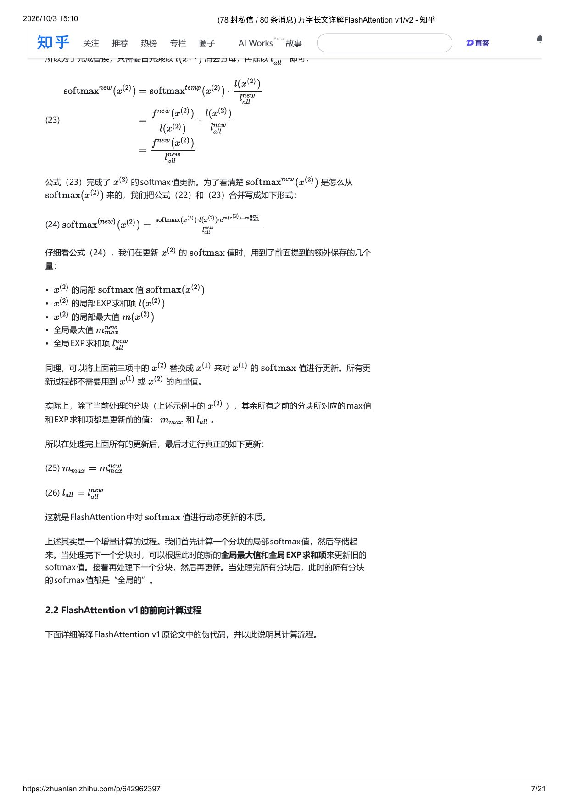
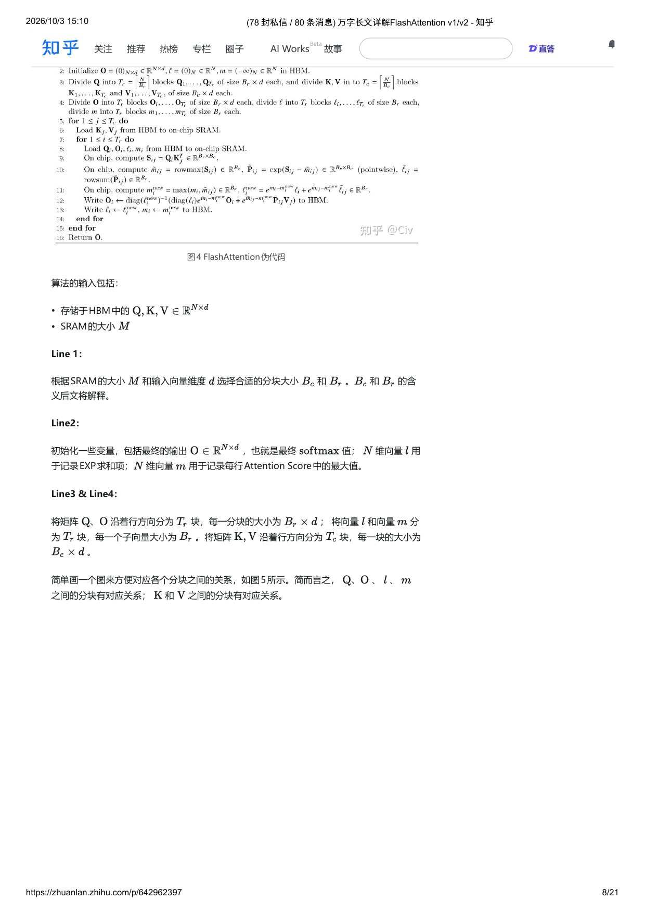
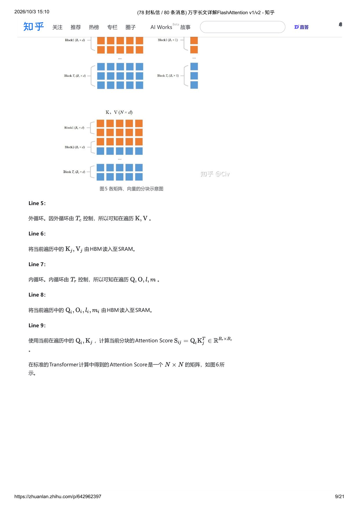
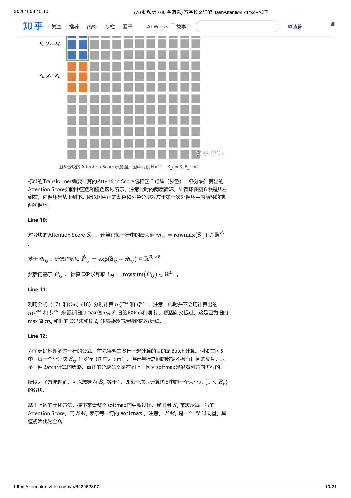
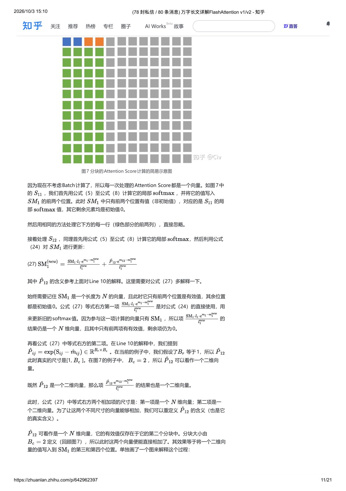
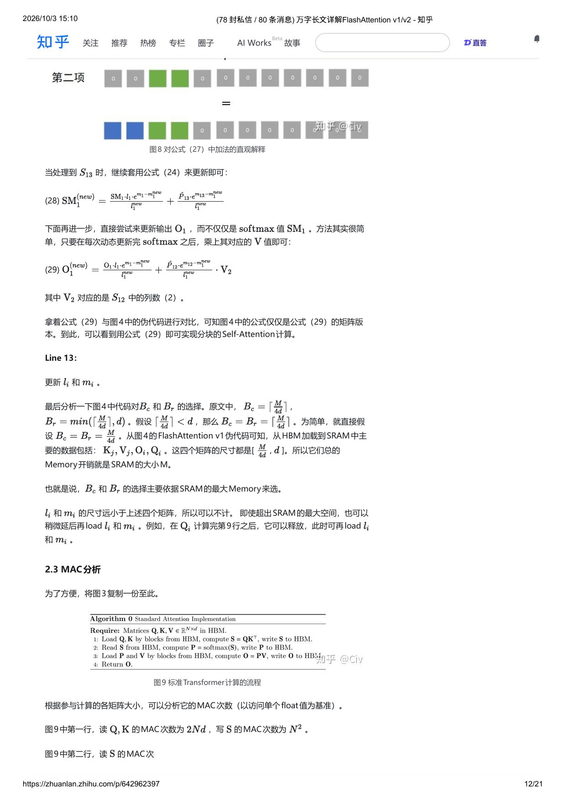

# FlashAttention v1 / v2 学习笔记

> 本文是对知乎专栏文章 [《万字长文详解 FlashAttention v1/v2》](https://zhuanlan.zhihu.com/p/642962397)（作者 Civ）的**结构化学习笔记**。
> 原文章节以「背景 & 动机 → FlashAttention v1 → FlashAttention v2 → Efficient Memory Attention → 基准测试」展开，
> 本笔记保留其推导主线与全部 48 个编号公式，并补充术语、记号对照与可复现的代码索引。

- **一句话总结**：FlashAttention 是一类 **IO 感知（IO-aware）的精确注意力算法**——它通过 **分块（tiling）+ 在线 softmax 重缩放（online softmax rescaling）** 把注意力计算全部留在 SRAM 中完成，从而把 HBM 访问量从 $O(N^2)$ 降到 $O(N^2 d^2/M)$，用「多算一点（重算 / 不物化中间矩阵）」换取「少搬运很多」。
- **它不是近似算法**（v1/v2 主体部分）：数学结果与标准 Self-Attention 一致，仅存在浮点数值上的微小差异。文中唯一的近似变体是 **Block-Sparse FlashAttention**。
- **v1 → v2 的杠杆**：v1 已经比标准实现快 2–4×，但 A100 上前向吞吐量仅达极限的 30–50%、反向 25–35%；v2 通过 **放宽在线 softmax 的缩放时机（Algorithm）+ 把行方向分块也纳入并行（Parallelism）+ 以 $K/V$ 而非 $Q/K/V$ 做 warp 切分（Work Partitioning）**，把吞吐量推到 A100 极限的 73%（230 TFLOPs/s）。

---

## 目录

- [0. 记号与术语对照](#0-记号与术语对照)
- [1. 背景与动机](#1-背景与动机)
- [2. FlashAttention v1](#2-flashattention-v1)
- [3. FlashAttention v2](#3-flashattention-v2)
- [4. Efficient Memory Attention（EMA）与 xformers](#4-efficient-memory-attentionema与-xformers)
- [5. 基准测试代码索引](#5-基准测试代码索引)
- [6. 复习清单（自测）](#6-复习清单自测)
- [附录 A. 全部编号公式](#附录-a-全部编号公式)
- [附录 B. 参考资料](#附录-b-参考资料)

---

## 0. 记号与术语对照

| 符号 | 含义 | 备注 |
| --- | --- | --- |
| $N$ | 序列长度 | 原文中有时记作 $n$ |
| $d$ | 单头维度（head dim） | |
| $B_r,\ B_c$ | 分块的行数 / 列数 | $B_r$ 用于 $Q$ 与 $O$，$B_c$ 用于 $K$ 与 $V$ |
| $T_r,\ T_c$ | 分块个数，$T_r=\lceil N/B_r\rceil,\ T_c=\lceil N/B_c\rceil$ | |
| $M$ | SRAM 容量（A100 约 100–192 KB 级） | |
| HBM | High Bandwidth Memory，显存，容量大但带宽相对低 | A100：40–80 GB |
| SRAM | Static RAM，片上共享内存，带宽极高但容量小 | 分块必须放得下 |
| FLOPs | Floating Point Operations，**浮点运算总次数**（工作量） | ⚠️ 不是 FLOP/s |
| FLOP/s | Floating Point Operations **Per Second**（吞吐率） | 原文评论区指出该处用词混淆 |
| MAC | Memory Access Cost，**存储访问开销**（读写字节数 / 次数） | 本笔记的核心优化目标 |
| Compute-bound | 计算密集型算子，耗时由 FLOPs 决定 | 大矩阵乘法、大 channel 卷积 |
| Memory-bound | 存储访问密集型算子，耗时由 MAC 决定 | ReLU、Dropout、求和、softmax、BatchNorm |
| EXP 求和项 | softmax 分母 $\sum_j e^{x_j-m}$ | 原文自造的说法，见公式 (7) |
| 局部 / 全局 | 只用某个分块信息算出的量 / 用全部分块信息算出的量 | 在线 softmax 的核心概念 |
| LSE | Log-Sum-Exp，$\log\sum_j e^{x_j}$ | v2 反向传播合并变量时出现 |

---

## 1. 背景与动机

### 1.1 Transformer 的复杂度

给定三个 $N\times d$ 的矩阵 $Q,K,V\in\mathbb{R}^{N\times d}$，标准 Self-Attention（略去缩放因子 $\sqrt d$，下同）：

```text
(1)  S = Q Kᵀ        ∈ R^{N×N}
(2)  P = softmax(S)  ∈ R^{N×N}
(3)  O = P V         ∈ R^{N×d}
```

- $Q,K,V$ 由原始输入经线性变换得到；
- $S$ 常被称为 **Attention Scores**；
- $P$ 是对 $S$ **逐行** 做 softmax 的结果，可理解为 Normalized Attention Scores 或 **Attention Weights**；
- $O$ 是最终输出；$N$ 是序列长度，$d$ 是维度。

**复杂度**：公式 (1) 与 (3) 是串行执行的两个 $N\times d$ 与 $d\times N$（及 $N\times N$ 与 $N\times d$）矩阵乘法，各自复杂度为 $O(N^2 d)$，因此

```text
Self-Attention 时间复杂度 = O(N² d)         即随 N 二次增长
Self-Attention 空间复杂度 = O(N²)  (当 N ≫ d)
```

> 原文用大 $O$（上界）而非原论文的 $\tilde O$（精确界）。二者的差别只是「上界」与「紧确界」；因为 $M\le N$ 时对应的大 $O$ 也成立，所以用大 $O$ 叙述不影响结论。

**工程含义**：Transformer 的上下文长度因此长期受限（早期 LLM 普遍 2k / 4k）。如今 32k 已是标配、百万 token 也不罕见——**但这不改变复杂度是 $O(N^2)$ 这一事实**，它只是把问题推给了更长的序列与更贵的显存。

### 1.2 FLOPs & MAC：为什么"更省计算"不等于"更快"

- FLOPs 定义模型核心计算的密集程度，与计算速度关系很大；
- 学术界大量 **Efficient Transformer** 只盯着降低 FLOPs，但 FlashAttention 作者发现：**它们的 FLOPs 确实降了，速度却没有显著变快**；
- 根因在于计算速度同时取决于 **MAC**。尤其当计算本身已经很高效率时，MAC 的占比越发不可忽视。MAC 开销来自两处：**从存储读数据** 与 **向存储写数据**（GPU 上即显存 ↔ 计算单元之间的搬运）。

按计算密集程度把 operator 分成两类：

| 类型 | 耗时主要来自 | 典型算子 | 决定耗时的量 |
| --- | --- | --- | --- |
| **Compute-bound** | 计算本身（读写耗时低） | 大矩阵乘法、大 channel size 卷积 | FLOPs |
| **Memory-bound** | 存储访问 | 逐元素操作（ReLU、Dropout）、Reduce 操作（求和、softmax、BatchNorm） | MAC |

两点结论：

1. 绝大多数神经网络含有大量 Memory-bound 操作，所以 MAC 不能忽略；而绝大多数 Efficient Transformer 忽略了它——这正是「FLOPs 降了、时耗没降」的原因。
2. **即使对传统意义上的 Compute-bound 操作（如大矩阵乘法），当计算本身已经非常高效时，MAC 开销也会变成瓶颈。FlashAttention 主要解决的正是这一类问题。**

> 同类研究动机的先例：CV 领域的 **ShuffleNet v2**（缅怀前辈）在轻量化模型只关注 FLOPs 的潮流中，同样强调了 MAC。

### 1.3 核心思路：用 SRAM 换 HBM，用 FLOPs 换 MAC

**目标：降低 MAC，即使代价是增加 FLOPs。**

**GPU 存储层级（以 A100 为例）**

```text
        ┌──────────────────────── 容量大、带宽相对低 ────────────────────────┐
        │  HBM (High Bandwidth Memory)  40–80 GB                            │
        └───────────────▲───────────────────────────────┬──────────────────┘
                        │  数据搬运 = MAC（要尽量少）      │
        ┌───────────────┴───────────────────────────────▼──────────────────┐
        │  SRAM (on-chip, Static RAM)  ~100–192 KB / SM                     │
        │  读写速度快得多，但空间远小于 HBM                                  │
        └──────────────────────────────────────────────────────────────────┘
```



- **SRAM 读写速度远大于 HBM，但空间远小于 HBM**（A100：SRAM 19 TB/s / 20 MB，HBM 1.5 TB/s / 40 GB，CPU DRAM 12.8 GB/s / >1 TB）；
- 标准 Transformer 的计算过程主要使用 HBM，涉及 **8 次 HBM 矩阵读写**（对应图 3 的三行）：第一行读 $Q,K$ 两次、写 $S$ 一次（共 3 次）；第二行读 $S$ 一次、写 $P$ 一次（2 次）；第三行读 $P,V$ 两次、写 $O$ 一次（3 次）；
- **FlashAttention 的做法**：把参与计算的矩阵 **分块（tile）** 送进 SRAM，在片上算完再写回，从而减少 HBM 读写总量。
- 难点：对普通矩阵乘法，分块很自然；但对 Self-Attention **不直观**，因为 softmax 的分母是一个依赖所有元素的求和项 —— 所以必须先解决 **softmax 的分块（在线）计算**。

---

## 2. FlashAttention v1

对 Self-Attention 做分块，真正难点是 **softmax 的分块计算**（$P=\mathrm{softmax}(S)$）。本节先给出在线 softmax 的推导（2.1），再对照论文伪代码走一遍前向（2.2），然后做 MAC 分析（2.3）。

### 2.1 Softmax 的动态更新（在线 softmax / online softmax）

#### 2.1.1 标准 softmax 与其数值问题

对维度为 $B$ 的向量 $x\in\mathbb{R}^B$：

```text
(4)  softmax(x₍ᵢ₎) = e^{x₍ᵢ₎} / Σⱼ e^{xⱼ}      i = 1..B
```

分子分母都含指数项，因此**既可能上溢也可能下溢**：

- 上溢：指数项 $e^{x_i}$ 中 $x_i$ 较大时值容易很大。例如 float32 下 $x_i\approx 88$ 时 $e^{x_i}$ 就会上溢；
- 下溢：当 $x$ 中每个元素都是较大的负值时，每个 $e^{x_i}$ 都可能下溢，分母为 0，整个式子因被除数为 0 而未定义。

#### 2.1.2 稳定版 softmax

几乎所有深度学习框架都使用 **稳定版**：先减去向量最大值。

```text
(5)  m(x)  = max([x₁, x₂, ..., x_B])                      ← 向量最大值
(6)  f(x)  = [ e^{x₁−m(x)}, e^{x₂−m(x)}, ..., e^{x_B−m(x)} ]
(7)  ℓ(x)  = Σⱼ f(x)ⱼ                                       ← "EXP 求和项"
(8)  softmax(x) = f(x) / ℓ(x)                               ← 逐元素相除
```

其中 $\ell(x)$ 是分母的求和项（原文称 **"EXP 求和项"**），$f(x)_i$ 表示向量 $f(x)$ 的第 $i$ 个元素。

**为什么能同时解决上溢和下溢**：每个 $x_i$ 减去最大值 $m(x)$ 后，分子最大只可能是 $e^0=1$，没有上溢可能；分母中至少有一项是 $e^0=1$，因此分母不会为 0。

**分块为什么难**：$\ell(x)$ 依赖于输入向量中的**每一个值**。

#### 2.1.3 把向量"一切为二"：局部量

把大小 $2B$ 的向量 $x$ 一分为二：

```text
x = [ x⁽¹⁾ , x⁽²⁾ ] ,   x⁽¹⁾, x⁽²⁾ ∈ R^B
```

即 $x^{(1)}$ 是前半部分、$x^{(2)}$ 是后半部分。先处理 $x^{(1)}$，用 (5)–(8) 计算它的**局部 softmax**：

```text
(9)   m(x⁽¹⁾)  = max([x₁⁽¹⁾, x₂⁽¹⁾, ..., x_B⁽¹⁾])
(10)  f(x⁽¹⁾)  = [ e^{x₁⁽¹⁾−m(x⁽¹⁾)}, ..., e^{x_B⁽¹⁾−m(x⁽¹⁾)} ]
(11)  ℓ(x⁽¹⁾)  = Σⱼ f(x⁽¹⁾)ⱼ
(12)  softmax(x⁽¹⁾) = f(x⁽¹⁾) / ℓ(x⁽¹⁾)
```

由 (9)–(12) 得到的 $\mathrm{softmax}(x^{(1)})$ **不是最终结果**，原因有二：

- (10) 中减去的最大值应当是整个向量 $x$ 的最大值 $m(x)$，而不是子向量的 $m(x^{(1)})$；
- (12) 中分母的 EXP 求和项应当是**关于整个向量 $x$** 的求和，而不仅是关于 $x^{(1)}$ 的求和。

所以称其为 **"局部的"**。

#### 2.1.4 保存额外标量并处理第二个分块

处理完 $x^{(1)}$ 后，只需要保存两个标量：$m(x^{(1)})$ 与 $\ell(x^{(1)})$（相比整个子向量，开销小得多）。此外还需保存两个**全局标量**：

- $m_{\max}$：**当前最大值**。目前只处理完 $x^{(1)}$，所以 $m_{\max}=m(x^{(1)})$；
- $\ell_{\max}$：**全局 EXP 求和项**。同理 $\ell_{\max}=\ell(x^{(1)})$。

接着处理 $x^{(2)}$：

```text
(13)  m(x⁽²⁾)  = max([x₁⁽²⁾, x₂⁽²⁾, ..., x_B⁽²⁾])
(14)  f(x⁽²⁾)  = [ e^{x₁⁽²⁾−m(x⁽²⁾)}, ..., e^{x_B⁽²⁾−m(x⁽²⁾)} ]
(15)  ℓ(x⁽²⁾)  = Σⱼ f(x⁽²⁾)ⱼ
(16)  softmax(x⁽²⁾) = f(x⁽²⁾) / ℓ(x⁽²⁾)          ← 同样是"局部"的
```

此时 (16) 得到的仍是局部的。但处理完 $x^{(2)}$ 后，就可以用新信息更新前面保存的两个全局标量。

**先更新 $m_{\max}$**（注意：此时只算出了新的 max 值，**不能**立刻替换旧的 $m_{\max}$，因为后面还要用旧值）：

```text
(17)  m_max^new = max([ m_max , m(x⁽²⁾) ])
```

含义很简单：更新后的全局最大值就是「旧全局最大值」与「本分块最大值」中更大的那个。

**再更新 $\ell_{\max}$**：

```text
(18)  ℓ_max^new = e^{m_max − m_max^new} · ℓ_max  +  e^{m(x⁽²⁾) − m_max^new} · ℓ(x⁽²⁾)
```

正确性推导：以 $\ell(x^{(2)})$ 为例，说它是"局部的"是因为它**只用了 $x^{(2)}$ 的信息**。把 (15) 稍微展开：

```text
(19)  ℓ(x⁽²⁾) = Σⱼ e^{xⱼ⁽²⁾ − m(x⁽²⁾)}
```

导致它是"局部"而非"全局"的原因，就是它减去的 max 是局部的 $m(x^{(2)})$。只需把这个 max 换成全局的：

```text
(20)  ℓ(x⁽²⁾) · e^{m(x⁽²⁾) − m_max^new} = Σⱼ e^{xⱼ⁽²⁾ − m_max^new}
```

此时 $\ell$ 已更新为"全局的"。

> **通用规则**：要把某个 EXP 求和项 $\ell$ 更新为"全局的"，只要乘上一个项
> ```text
> e^{ m_local − m_global }
> ```
> 其中 $m_{\text{local}}$ 表示当前 $\ell$ 对应的（局部）最大值，$m_{\text{global}}$ 表示当前全局最大值。

回到 (18)：$\ell^{(1)}$ 对应的最大值是 $m(x^{(1)})$、当前全局最大值是 $m_{\max}^{\text{new}}$，所以乘 $e^{m(x^{(1)})-m_{\max}^{\text{new}}}$ 更新 $\ell^{(1)}$（等式右方第一项）；同理用 $e^{m(x^{(2)})-m_{\max}^{\text{new}}}$ 更新 $\ell^{(2)}$（第二项）；两项求和即得当前的全局 EXP 求和项。

**再更新 softmax 值本身**。参考 (16)，当前**分子和分母都是局部的**，需要分别更新至全局。先看分子 $f(x^{(2)})$（由 (14) 定义）：

```text
(21)  f(x⁽²⁾) · e^{m(x⁽²⁾) − m_max^new} = [ e^{x₁⁽²⁾−m_max^new}, ..., e^{x_B⁽²⁾−m_max^new} ]
```

此时每一项都是"全局的"。**很容易发现：更新 $f$ 的方法与更新 $\ell$ 其实一样，都是乘上同一个项 $e^{m_{\text{local}}-m_{\text{global}}}$。**

先把 (16) 的分子乘上它，把分子更新为"全局的"：

```text
(22)  softmax(x⁽²⁾)^new_num = f(x⁽²⁾) · e^{m(x⁽²⁾) − m_max^new} / ℓ(x⁽²⁾)
```

注意 (22) 只是更新了分子、还没更新分母，所以不是最终结果。离最终结果只差一步：分母中的局部 EXP 求和项 $\ell(x^{(2)})$ 需要被替换成全局项 $\ell_{\max}^{\text{new}}$（已由 (18) 算出）。为完成替换，先乘以 $\ell(x^{(2)})$ 消去分母，再除以 $\ell_{\max}^{\text{new}}$：

```text
(23)  softmax(x⁽²⁾)^new = (f(x⁽²⁾) · e^{m(x⁽²⁾) − m_max^new}) / ℓ_max^new
```

把 (22) 与 (23) 合并，即可看清"更新"的来源：

```text
(24)  softmax(x⁽²⁾)^new = softmax(x⁽²⁾) · [ ℓ(x⁽²⁾) · e^{m(x⁽²⁾) − m_max^new} ] / ℓ_max^new
```

**更新时所依赖的额外保存量**（公式 (24) 用到的全集）：

- $x^{(2)}$ 的局部 softmax 值 $\mathrm{softmax}(x^{(2)})$
- $x^{(2)}$ 的局部 EXP 求和项 $\ell(x^{(2)})$
- $x^{(2)}$ 的局部最大值 $m(x^{(2)})$
- 全局最大值 $m_{\max}^{\text{new}}$
- 全局 EXP 求和项 $\ell_{\max}^{\text{new}}$

同理，把前三项里的 $x^{(2)}$ 换成 $x^{(1)}$ 就能更新 $x^{(1)}$ 的 softmax 值。**所有更新过程都不需要 $x^{(1)}$ 或 $x^{(2)}$ 的原始向量值**——这正是它省显存的关键。

**最后（处理完全部分块后）才做真正的全局更新**：

```text
(25)  m_max^final = m_max^new
(26)  ℓ_max^final = ℓ_max^new
```

> **这就是 FlashAttention 对 softmax 值进行动态更新的本质。**
> 本质上是**增量计算**：先算一个分块的局部 softmax 并保存；处理下一个分块时，用新的全局最大值与全局 EXP 求和项去更新旧值；处理完所有分块后，所有分块的 softmax 值都变成了"全局的"。
> 注意除当前分块外，其余所有之前分块对应的 max 与 EXP 求和项都还是**更新前**的值——所以 (17)(18) 算出的新值先不能替换旧值。

### 2.2 FlashAttention v1 的前向计算过程（对照论文伪代码）

**算法输入**：

- $Q,K,V\in\mathbb{R}^{N\times d}$，存储于 HBM；
- SRAM 的大小 $M$。



逐步对照伪代码（图 4）：

| 行 | 内容 | 笔记 |
| --- | --- | --- |
| **Line 1** | 根据 SRAM 大小 $M$ 与维度 $d$ 选择分块大小 $B_r,B_c$ | 选择依据见本节末尾 |
| **Line 2** | 初始化 $O=(0)_{N\times d}\in\mathbb{R}^{N\times d}$、$\ell=(0)_N\in\mathbb{R}^N$、$m=(-\infty)_N\in\mathbb{R}^N$（写在 HBM） | $\ell$ 记录 EXP 求和项，$m$ 记录每行 Attention Score 的最大值 |
| **Line 3–4** | 把 $Q$ 沿**行**方向分 $T_r$ 块、每块 $B_r\times d$；把 $\ell,m$ 各分 $T_r$ 个子向量（大小 $B_r$）；把 $K,V$ 沿行方向各分 $T_c$ 块、每块 $B_c\times d$ | 对应关系：$Q,K,V$ 的分块互相对应；$\ell,m$ 与 $O$ 的行分块对应 |


| **Line 5** | 外循环，遍历 $1\le i\le T_r$ | |
| **Line 6** | 把当前 $Q_i$ 由 HBM 读入 SRAM | |
| **Line 7** | 内循环，遍历 $1\le j\le T_c$ | |
| **Line 8** | 把当前 $K_j,V_j$ 由 HBM 读入 SRAM | |
| **Line 9** | 用当前 $Q_i,K_j$ 计算当前分块的 Attention Score $S_{ij}=Q_iK_j^T\in\mathbb{R}^{B_r\times B_c}$ | 标准 Transformer 需要的是整个 $N\times N$ 矩阵；各分块结果如图 6 的蓝/橙区域。**外循环在图 6 中从左到右，内循环从上到下** |
| **Line 10** | 对 $S_{ij}$ 求每行最大值 $\tilde m_{ij}=\mathrm{rowmax}(S_{ij})\in\mathbb{R}^{B_r}$；据此算指数项 $P_{ij}=\exp(S_{ij}-\tilde m_{ij})\in\mathbb{R}^{B_r\times B_c}$（逐元素）；再求 EXP 求和项 $\tilde\ell_{ij}=\mathrm{rowsum}(P_{ij})\in\mathbb{R}^{B_r}$ | |
| **Line 11** | 用公式 (17)(18) 分别计算 $m_i^{\text{new}},\ell_i^{\text{new}}$ | ⚠️ **此时不用新值覆盖旧的 $m_i,\ell_i$**，因为旧值还要参与后续计算（见 2.1.4） |
| **Line 12** | 更新 $O_i\leftarrow\mathrm{diag}(\ell_i^{\text{new}})^{-1}\big(\mathrm{diag}(\ell_i)e^{m_i-m_i^{\text{new}}}O_i+e^{m_i-m_i^{\text{new}}}P_{ij}V_j\big)$，并写回 HBM | 下文详述 |
| **Line 13** | 更新 $\ell_i\leftarrow\ell_i^{\text{new}},\ m_i\leftarrow m_i^{\text{new}}$ | |

**Line 12 的直观理解**（原文较细，值得单独记）：





1. **多行一起算的目的只是 Batch 计算**。在图 6 中每个小分块 $S_{ij}$ 有 $B_r$ 行（图中为 3 行），但**行与行之间没有任何数据交互**，只是一种 batch 策略。**真正的分块意义在列上，因为 softmax 是沿着列方向（行内归一化）进行的。** 所以理解时可以想象 $B_r=1$，每次只算一个 $1\times B_c$ 的分块（图 7）。
2. 用 $x^{(1)}$ 表示某一个分块的 Attention Score 行向量，用 $O_i$ 表示该行最终的输出，$O_i$ 是 $d$ 维向量、初始化为全 0。
3. 先处理最左侧分块 $x^{(1)}$：用 (5)–(8) 算它的**局部 softmax**，把值写入 $O_i$ 的**前 $B_c$ 个位置**。此时 $O_i$ 只有前两个位置有值（图 7 中 $B_c=2$），其余仍为初始值 0。
4. 处理第二个分块 $x^{(2)}$：先算局部 softmax，再用 (24) 更新：

   ```text
   (27)  O_i ← diag(ℓ_i^new)⁻¹ ( diag(ℓ_i) e^{m_i − m_i^new} O_i  +  e^{m_i − m_i^new} P_{ij} V_j )
   ```

   - $O_i$ 始终是长度 $N$ 的向量，此时只有前两个位置是有效值。等式右方**第一项**是对 (24) 的直接使用，用来更新旧的 softmax 值；因为参与这一项计算的向量只有 $x^{(1)}$，所以结果仍是 $N$ 维向量，只有前两项有效。
   - 等式右方**第二项**：在 Line 10 的解释中提到 $P_{ij}$ 的真实尺寸是 $[1,B_c]$；图 7 中 $B_c=2$，所以 $P_{ij}V_j$ 是一个二维（$B_c$ 维）向量。
   - 为了把 $N$ 维向量与 $B_c$ 维向量相加，**需要重新理解 $O_i$ 的含义（也是它的真实含义）：$O_i$ 是一个 $N$ 维向量，但它的有效值仅分布在"当前正在处理的那个分块"对应的位置上**，分块大小由 $B_c$ 定义。于是这个加法等价于「把一个 $B_c$ 维向量的值写入 $O_i$ 的第 3、4 个位置」（图 8 专门解释了这一点）：

      
5. 处理 $x^{(3)}$ 时继续套用 (24)：

   ```text
   (28)  softmax(x⁽³⁾)^new = softmax(x⁽³⁾) · [ ℓ(x⁽³⁾) · e^{m(x⁽³⁾) − m_max^new} ] / ℓ_max^new
   ```

6. **再进一步：直接更新输出 $O$ 而不只是 softmax 值**——只要在每次动态更新完 softmax 之后，乘上其对应的 $V$ 分块即可：

   ```text
   (29)  O_i = Σⱼ (更新后的 softmax(x⁽ʲ⁾)) · V_j          B_c 对应公式中 V 的列数（示例为 2）
   ```

   把 (29) 与图 4 伪代码对照可知：**图 4 中的公式只是 (29) 的矩阵版本**。至此，用 (29) 就实现了分块的 Self-Attention 计算。

**关于 $B_r,B_c$ 的选择**：论文中取

```text
B_r = min( ⌈M / (4d)⌉ , d )        B_c = min( ⌈M / (4d)⌉ , d )
```

假设 $d=64$、$M=100\text{KB}$，则 $B_r=B_c=\lceil 100\text{KB}/(4\times 64)\rceil\approx 384$。简化起见可直接设 $B_r=B_c=\lceil M/(4d)\rceil$。

从伪代码可知，从 HBM 加载到 SRAM 的主要数据是 $Q_i,K_j,V_j,O_i$，这四个矩阵尺寸都是 $[B_r,d]$（或 $[B_c,d]$），因此它们总的内存开销就是 SRAM 大小 $M$。**也就是说 $B_r,B_c$ 主要依据 SRAM 最大容量来选。** $\ell_i,m_i$ 尺寸远小于上述四个矩阵，可以不计；即使超出 SRAM，也可以稍延后再 load（例如 $O_i$ 在第 9 行算完后可释放，此时再 load $\ell_i,m_i$）。

### 2.3 MAC 分析



结合图 9（= 图 3，标准 Transformer 流程），以访问单个 float 为基准统计读写次数：

**标准 Transformer**

| 行 | 操作 | MAC 次数 |
| --- | --- | --- |
| 第一行 | 读 $Q,K$ | $2Nd$ |
| 第一行 | 写 $S$ | $N^2$ |
| 第二行 | 读 $S$ | $N^2$ |
| 第二行 | 写 $P$ | $N^2$ |
| 第三行 | 读 $P,V$ | $N^2+Nd$ |
| 第三行 | 写 $O$ | $Nd$ |

总计 $4N^2+4Nd$，忽略常数项后复杂度为

```text
标准 Self-Attention 的 MAC = O(N²)
```

**FlashAttention v1**：主要关注 $K,V$ 的开销，因为 $K,V$ 在**内循环**，其 MAC 占绝大多数。

- 一次完整的内循环需要读取完整的 $K,V$，MAC 开销 $O(Nd)$；
- 外循环决定内循环执行次数，即 $T_r=N/B_r$ 次。

所以 FlashAttention v1 的开销为

```text
FA v1 的 MAC = O(N²d²/M)      （外循环次数 × 每次内循环开销）
```

因为 $M$（约 100 KB）通常远大于 $d$（数 K 字节量级），所以 **FlashAttention v1 的 MAC 远小于标准 Transformer**。

> 原文用 $O$ 而非 $\tilde O$：$O$ 表示上界，$\tilde O$ 表示精确界（既是上界也是下界）。本文用大 $O$ 主要因为它更常见，且 $M\le N$ 时对应的大 $O$ 也成立。

### 2.4 反向过程（Backward Pass）的显存技巧

反向过程与前向高度相关、思路接近，不再赘述细节。除采用类似前向的分块方法来降低 MAC 之外，还用了两个技巧降低整体 Memory 开销：

1. **重算 $S,P$ 而不保存**：反向传播需要矩阵 $S$ 和 $P$ 来计算关于 $Q,K,V$ 的梯度。但可以通过保存输出 $O$ 与最大值 $m$、EXP 求和项 $\ell$ 来**重算** $S$ 和 $P$，从而节省内存开销。
2. **保存 RNG 状态而非 Dropout Mask**：通过保存前向过程的随机数生成器状态，在反向过程中重新生成 Dropout 的 Mask，从而节约存储所有 Dropout Mask 的开销。

### 2.5 Block-Sparse FlashAttention

为进一步降低 MAC，论文设计了简单的 Block-Sparse FlashAttention：图中蓝色和橙色块正常参与计算（用不同颜色只为区分），**灰色分块被 mask 住、完全不参与计算**，因此总 MAC 降低。



> ⚠️ **Block-Sparse FlashAttention 是一种近似算法，不是精确的 Transformer。** 这是全文唯一非精确的变体。

### 2.6 实验结果

结论很简单：**使用 FlashAttention 可以明显提高计算速度**（v1 相对标准 self-attention 提速 2–4×）。

---

## 3. FlashAttention v2

**动机**：v1 虽已把标准 self-attention 提速 2–4×，但**整体吞吐量仍然较低**——A100 上 v1 的 forward 吞吐量只有 GPU 极限的 30%–50%，backward 甚至只有 25%–35%。v2 的目标就是在此基础上进一步提升吞吐量。

v2 的优化点较零散，论文归为三类：**Algorithm、Parallelism、Work Partitioning**。

### 3.1 算法（Algorithm）

#### 3.1.1 前向过程：去掉每步的除法

把 (23) 复制过来作为 (30)：

```text
(30)  softmax(x⁽²⁾)^new = (f(x⁽²⁾) · e^{m(x⁽²⁾) − m_max^new}) / ℓ_max^new
```

观察 (30) 的第二、三行：为了把 $x^{(2)}$ 的 softmax 更新至全局，需要做**分母替换**——把局部 EXP 求和项替换为全局的；替换逻辑是**先乘上原来的分母，再除以新的全局 EXP 求和项**。

**关键洞察**：如果 $x$ 被"一分为三"，那么 $x^{(2)}$ 的 softmax 在由 (30) 更新后，处理完 $x^{(3)}$ 时**还要再更新一次**——又要乘以"上一次的全局 EXP 求和项"，并除以此时新的全局 EXP 求和项。也就是说，(30) 里刚除掉的 $\ell_{\max}^{\text{new}}$，在下一次更新时会被乘回来**相互抵消**。

**因此，每次分块计算完毕后不必除以当时的 EXP 求和项，只需等到最后直接除以最终的全局 EXP 求和项即可。**

```text
(31)  softmax(x⁽²⁾)^partial = f(x⁽²⁾) · e^{m(x⁽²⁾) − m_max^new}      ← 不除分母，也不更新 ℓ
```

对比 (31) 与 (30)：本质是**每一次迭代都不再除以 EXP 求和项**（(30) 分母处的 $\ell_{\max}^{\text{new}}$）；因为不除了，也就**无需对 EXP 求和项做更新**（无需再乘 $e^{m_{\text{local}}-m_{\text{global}}}$）。直到处理完最后一个分块，直接用此时的全局 EXP 求和项做分母。

**平均值的类比**（原文给的直觉，非常有助于记忆）。假设要算 1 到 10 的平均值，但每次只能算两个数：

- **FA v1 的做法（精确的滚动平均）**：第一次算出前两个数的平均值 $=1.5$，记录已算个数 $N=2$；第二次算前三个数的平均值，需要用之前的 $N=2$ 来更新，$N=3$；以此类推。**每一步算出的都是"前 N 个数精确的平均值"**，有新值来了再更新到新的全局平均值。
- **FA v2 的做法（滚动求和，最后一次除）**：第一次算出前两个数的**和**，$N=2$；第二次算出前三个数的**和**，$N=3$；以此类推。**算完后只需把总和除以 $N$**。
- **v2 的优势：少了原来每一步的乘法和除法。**

**针对 Causal Masking 的优化**：自回归训练时需要 Mask 作用在 Attention Score 矩阵上，保证每个 token 不会 attend 到它之后的 token。这个过程中 Attention Score **仍被完整计算**，即使接近一半的元素会被 mask 掉而不被使用。因为 v1 本身就是基于分块计算的，**如果某个分块需要被完全 mask，就可以直接跳过该分块、不做任何计算**。这个简单的方法可以加速 attention 计算 **1.7–1.8×**。

#### 3.1.2 反向过程：合并两个保存量

FA v1 在反向过程中用如下方式计算分块的 attention weight $P_{ij}$（参考原论文 Algorithm 4 第 13 行，为简洁忽略 mask）：

```text
(32)  P_{ij} = exp(S_{ij} − m_i) / ℓ_i
```

为了算出 (32)，需要保存**两个**变量：$m_i$ 与 $\ell_i$。FA v2 把二者合并为**一个**变量：

```text
(33)  P_{ij} = exp(S_{ij} − L_i)
(34)  其中  L_i = log(ℓ_i) + m_i          （即 Log-Sum-Exp, LSE）
```

> **为什么能省**：$\ell_i$ 是 softmax 分母、$m_i$ 是行最大值，二者都是 $N$ 维向量。v1 反向要同时读 $m_i$ 与 $\ell_i$ 才能重建 $P_{ij}$；v2 只保存一个 LSE 向量 $L_i$，反向只需一次读取，**MAC 与显存都减半**。

### 3.2 并行（Parallelism）

先补 GPU 基本工作原理：

- GPU 相对 CPU 的特点是**非常适合并行任务**，因为它含有大量计算单元。单个计算单元通常不如 CPU 强大，但大量计算单元可以**同时**完成并行任务；
- GPU 依靠 **thread** 完成计算，thread 按 **thread block** 的形式组织管理；这些 thread block 最终被调度到 **streaming multiprocessors (SM)** 上计算；
- 每个 thread block 中每 **32 个 thread 构成一个 warp**；同一个 warp 内的 thread 可以**协作完成矩阵乘法**；同一个 thread block 内的所有 warp 可以**共享存储空间**；
- **SM 是 GPU 中真正的物理计算单元，A100 一共有 108 个 SM**。要提高计算吞吐量，就需要尽可能保证**每个时刻有较多的 SM 同时在参与计算**。

#### 3.2.1 v1 的并行策略

- v1 的并行**主要在 attention head 之间**：一次前向中，同一 self-attention block 中的 heads 可以并行计算；
- 又因为同一 batch 中的数据也是并行处理的，所以 v1 **实际在 batch 与 attention head 两个维度同时并行**；
- v1 **用一个 thread block 处理一个 attention head**。当总并行数（batch size × head 数）足够大时，同时参与计算的 SM 更多，整体吞吐量自然更高。
- ⚠️ **问题**：随着 LLM 上下文窗口越来越长，**单卡上 batch size 通常变得非常小**，因此实际可并行的 attention head 数量可能**远远少于 SM 数量**，导致系统整体吞吐量较低。

#### 3.2.2 v2 的并行策略

要想解决上面的问题，就得思考**除了 batch 与 attention head，还能在哪些维度并行**。

其实在介绍 v1 时已经提到过另一种并行策略：图 6、图 7 所示的**同一分块内每一行的计算之间没有任何信息交互**，多行一起算本来就只是一种并行策略。因此**当现有并行策略无法完全利用 SM 时，可以让更多行一起并行计算**（例如让图 6 中蓝色 block 与橙色 block 并行）——这种并行策略对应 v1 的**内循环**。

**v2 交换了内、外循环的顺序**，但本质不变。所以 **v2 实际上是在 v1 的并行策略基础上，增加了外循环（行方向）的并行。** 反向过程类似，只有细微差异。

### 3.3 计算分片（Work Partitioning）

- 每个 thread block 负责某个分块的一个 attention head 的计算；
- 每个 thread block 内，thread 又被组织为多个 **warp**，每个 warp 中的 thread 可以协同完成矩阵乘法；
- **Work Partitioning 主要针对 warp 的组织优化**。

**牢记：矩阵乘法本身是可分块计算的。** 因此可以充分利用多个 warp 的计算能力对矩阵做分块处理，加快整体计算。

**v1 的做法**：thread block 中的 thread 分 **4 个 warp**，把 **$K$ 和 $V$ 划分为 4 个分块**与每个 warp 对应；**对 $Q$ 不进行分块**。设序列长度为 $N$、维度为 $d$（$d\le 128$），则 $K,V$ 按序列长度维度分片为 $K_1,K_2,K_3,K_4$ 和 $V_1,V_2,V_3,V_4$，大小都是 $(N/4,d)$。以 $K_1,V_1$ 为例：

```text
(35)  S₁ = Q K₁ᵀ        ∈ R^{N×(N/4)}
(36)  P₁ = softmax(S₁)  ∈ R^{N×(N/4)}
(37)  O₁ = P₁ V₁        ∈ R^{N×d}
```

由 (35)–(37) 可知，**每一分块计算出的输出 $O_1$ 与最终输出的尺寸一致**，因此需要把 $O_1,O_2,O_3,O_4$ **相加**才能得到最终输出 $O$。

所以：
1. 每个 warp 按照 (35)–(37) 根据自己的分块计算；
2. 把结果写入**共享存储区域**；
3. **同步（sync）完成后将结果相加**得到最终输出。

> ⚠️ 代价：**warp 之间需要通信/同步，还要做额外的加法及其读写。**

**v2 的做法**：**对 $Q$ 进行分块**，而不是对 $K,V$ 分块。把 $Q$ 分成 $Q_1,Q_2,Q_3,Q_4$，尺寸都是 $(N/4,d)$。以 $Q_1$ 为例：

```text
(38)  S₁ = Q₁ Kᵀ        ∈ R^{(N/4)×N}
(39)  P₁ = softmax(S₁)  ∈ R^{(N/4)×N}
(40)  O₁ = P₁ V         ∈ R^{(N/4)×d}
```

由 (38)–(40) 可知，**v2 的分块策略只需把每个分块的结果拼接（concat）就能得到最终结果**：

- **warp 之间无需通信**；
- **减少了额外的加法以及它对应的读写操作**；

因此 v2 的分块策略更加高效。

### 3.4 实验结果

- FA v2 比 FA v1 快 **1.3–3×**；
- FA v2 比标准 self-attention 快 **3–10×**；
- 在 A100 上 FA v2 能达到 **230 TFLOPs/s，是 A100 极限的 73%**。

---

## 4. Efficient Memory Attention（EMA）与 xformers

这一节介绍另一种常用的 self-attention 加速算法 **EMA（Efficient Memory Attention）**。正如其名，EMA 原本主要为解决 self-attention 的**空间复杂度**问题而设计。attention 加速库 **xformers** 对 EMA 进一步做了速度优化，后来被大量 LLM 使用。

### 4.1 EMA 中的存储优化

把 self-attention 的计算公式改写为**向量形式**，关注某个特定 Query（如 $q_i$）：

```text
(41)  s_i = q_i Kᵀ         ∈ R^n
(42)  p_i = softmax(s_i)   ∈ R^n
(43)  o_i = p_i V          ∈ R^d          = Σⱼ p_{ij} v_j   （加权和）
```

- (43) 实际是一个**加权和**，权重由 (42) 的 softmax 计算得到；
- 要计算 (43)，必须**保存 (42) 得到的所有权重**，因此空间复杂度为 $O(n)$（$n$ 为序列长度）；
- 以上针对**某个特定 Query**；而 self-attention 通常同时处理所有 Query，所以**整体空间复杂度变为 $O(n^2)$**。

把 (42) 代入 (43)，得到更完整的 $o_i$ 表达式：

```text
(44)  o_i = ( Σⱼ e^{s_{ij}} v_j ) / ( Σⱼ e^{s_{ij}} )          j = 1..n
```

**注意到 (44) 最后一个等式右项的分子、分母都是求和项，且都是从索引 1 求和到索引 $n$。** 于是有一种优化计算方法：**对分子和分母分别用一个临时变量保存前 $n$ 项的求和结果**；计算第 $n+1$ 项时，只需单独算出第 $n+1$ 项的值再加上之前的求和结果。

例如，用两个变量分别保存分子、分母截至索引 $i$ 的求和结果：

```text
(45)  num_i = Σ_{j≤i} e^{s_ij} v_j
(46)  den_i = Σ_{j≤i} e^{s_ij}
```

当需要算 $i+1$ 的分子分母时，只需做增量更新：

```text
(47)  num_{i+1} = num_i + e^{s_{i,i+1}} v_{i+1}
(48)  den_{i+1} = den_i + e^{s_{i,i+1}}
```

当 $i=n$ 时，(47)(48) 就计算出了 (44) 中的分子与分母，所以 **(47) ÷ (48) 就得到正确的 $o_i$**。与 (41)–(43) 的写法不同，(47)(48) 在计算过程中**只需额外保存两个量，且与序列长度 $n$ 无关**，因此空间复杂度是 $O(1)$（针对单个 Query）。

如果对所有 Query 也**按顺序执行**（而非标准 self-attention 的并行执行），那么整个 self-attention 的空间复杂度就是 $O(n)$。实际中通常还需要保存 $Q,K,V$ 的索引，因此索引开销（二进制索引）的复杂度是 $O(n\log n)$。

> **EMA 把空间复杂度从 $O(n^2)$ 降到 $O(n)$，代价是计算时间的增加。**

原论文实验中，当序列长度为 **16,384** 时：标准 self-attention 的存储开销是 **1 GB**，而 EMA 仅 **17 MB**；EMA 的耗时增加约 **10%–15%**。

> **与 FlashAttention v2 的关系**：v2 的做法（公式 (30)(31)）其实和 EMA 类似——都是"先累加、最后再归一化"的在线计算思想。区别在于 FlashAttention 是在 SRAM 内分块完成并做了 IO 层面的优化，而 EMA 关注的是把中间权重矩阵彻底消掉。

### 4.2 xformers

- xformers 是一个 attention 加速库，其文档提到关键特性之一正是 Efficient Memory Attention；
- ⚠️ **但 xformers 所谓的 Efficient Memory Attention 并不特指 4.1 节的 EMA 方法**，它指**一系列**对存储友好的 attention 变体方法，**包括 FlashAttention**；
- 在 xformers 中使用 Efficient Memory Attention 时，它会**自动根据用户输入选择使用何种 attention 算子**；这些候选算子中，**FlashAttention 的优先级最高**。

---

## 5. 基准测试代码索引

文中介绍的所有方法官方都给出了基准测试代码，汇总如下（感兴趣的可以自行跑一下）：

| 项目 | Benchmark 路径 / 链接 |
| --- | --- |
| FlashAttention v1/v2 | `flash-attention/benchmarks/benchmark_flash_attention.py` |
| xformers | `xformers/xformers/benchmarks/benchmark_mem_eff_attention.py` |
| PyTorch SDPA | [Implementing High-Performance Transformers with Scaled Dot Product Attention (SDPA) — PyTorch Tutorials](https://pytorch.org/tutorials/intermediate/scaled_dot_product_attention_tutorial.html) |

**PyTorch 2.2 中已经有了 self-attention 的高效实现（SDPA）**，上面链接中有相关介绍和 benchmark 代码。

> 补充（来自原文评论区的高质量讨论）：SDPA 能走到 flash 后端（与 FA2 同速）的常见条件——dtype 为 fp16/bf16、较新 GPU（Ampere sm80+ / Hopper）、head_dim 受支持（≤256；Qwen3 文本头是 128）、mask 为 causal 或无 mask、**不要求返回注意力权重**、张量布局连续对齐。反过来会掉到 MATH 后端而明显变慢的情形：fp32 输入、要求输出注意力权重（`output_attentions=True`）、传入 flash 不支持的浮点加性 mask/bias、head_dim 超范围、老显卡或跑在 CPU 上。

---

## 6. 复习清单（自测）

**概念层**

1. 为什么"降低 FLOPs"未必带来"降低耗时"？MAC 在什么条件下成为主瓶颈？
2. Compute-bound 与 Memory-bound 各举三个例子；softmax 属于哪一类？
3. HBM 与 SRAM 在容量、带宽上的取舍是什么？FlashAttention 用哪一层做计算、哪一层做存储？
4. 标准 Transformer 的 8 次 HBM 读写分别是什么？

**推导层**

5. 为什么稳定版 softmax 能同时解决上溢和下溢？
6. 把向量一分为二时，(12) 得到的 softmax 为什么是"局部的"？两个原因分别是什么？
7. 写出把局部 EXP 求和项更新为全局项的通用乘子，并解释它的物理含义。
8. 公式 (24) 中的更新为什么不需要 $x^{(1)},x^{(2)}$ 的原始向量值？
9. v2 为什么可以不在每一步除以 EXP 求和项？用"1 到 10 求平均"的类比复述。
10. v2 反向把 $m_i$ 与 $\ell_i$ 合并为 $L_i=\log\ell_i+m_i$，省下的是什么（显存？MAC？两者？）？

**工程层**

11. $B_r,B_c$ 如何选？约束来自哪里？
12. v1 的并行维度有哪些？长上下文为什么让它失效？
13. v2 增加了哪个维度的并行？为什么交换内外循环就能增加并行度？
14. v1 的 Work Partitioning 为什么需要 warp 间同步与额外加法？v2 为什么不需要？
15. Block-Sparse FlashAttention 与 EMA 分别是"精确"还是"近似"？各自降低的是 MAC 还是 Memory？

---

## 附录 A. 全部编号公式

> 说明：原 PDF 中的公式为**矢量绘制**（无法直接提取文本），下述公式由页面图像 OCR + 上下文推导复原；符号沿用原文记号。

**Self-Attention 定义**

```text
(1)  S = Q Kᵀ        ∈ R^{N×N}
(2)  P = softmax(S)  ∈ R^{N×N}
(3)  O = P V         ∈ R^{N×d}
```

**稳定版 softmax（全局）**

```text
(4)  softmax(x_i) = e^{x_i} / Σⱼ e^{x_j}
(5)  m(x)      = max([x₁, …, x_B])
(6)  f(x)      = [ e^{x₁−m(x)}, …, e^{x_B−m(x)} ]
(7)  ℓ(x)      = Σⱼ f(x)ⱼ                       ← EXP 求和项
(8)  softmax(x)= f(x) / ℓ(x)
```

**第一个分块的局部 softmax**

```text
(9)   m(x⁽¹⁾)  = max([x₁⁽¹⁾, …, x_B⁽¹⁾])
(10)  f(x⁽¹⁾)  = [ e^{x₁⁽¹⁾−m(x⁽¹⁾)}, …, e^{x_B⁽¹⁾−m(x⁽¹⁾)} ]
(11)  ℓ(x⁽¹⁾)  = Σⱼ f(x⁽¹⁾)ⱼ
(12)  softmax(x⁽¹⁾) = f(x⁽¹⁾) / ℓ(x⁽¹⁾)
```

**第二个分块的局部 softmax**

```text
(13)  m(x⁽²⁾)  = max([x₁⁽²⁾, …, x_B⁽²⁾])
(14)  f(x⁽²⁾)  = [ e^{x₁⁽²⁾−m(x⁽²⁾)}, …, e^{x_B⁽²⁾−m(x⁽²⁾)} ]
(15)  ℓ(x⁽²⁾)  = Σⱼ f(x⁽²⁾)ⱼ
(16)  softmax(x⁽²⁾) = f(x⁽²⁾) / ℓ(x⁽²⁾)
```

**在线更新（动态更新）**

```text
(17)  m_max^new   = max([ m_max , m(x⁽²⁾) ])
(18)  ℓ_max^new   = e^{m_max − m_max^new} · ℓ_max  +  e^{m(x⁽²⁾) − m_max^new} · ℓ(x⁽²⁾)
(19)  ℓ(x⁽²⁾)     = Σⱼ e^{xⱼ⁽²⁾ − m(x⁽²⁾)}
(20)  ℓ(x⁽²⁾) · e^{m(x⁽²⁾) − m_max^new} = Σⱼ e^{xⱼ⁽²⁾ − m_max^new}
(21)  f(x⁽²⁾) · e^{m(x⁽²⁾) − m_max^new} = [ e^{x₁⁽²⁾−m_max^new}, …, e^{x_B⁽²⁾−m_max^new} ]
(22)  softmax(x⁽²⁾)^new_num = f(x⁽²⁾) · e^{m(x⁽²⁾) − m_max^new} / ℓ(x⁽²⁾)
(23)  softmax(x⁽²⁾)^new     = f(x⁽²⁾) · e^{m(x⁽²⁾) − m_max^new} / ℓ_max^new
(24)  softmax(x⁽²⁾)^new     = softmax(x⁽²⁾) · [ ℓ(x⁽²⁾) · e^{m(x⁽²⁾) − m_max^new} ] / ℓ_max^new
(25)  m_max^final = m_max^new
(26)  ℓ_max^final = ℓ_max^new
```

**分块 Self-Attention**

```text
(27)  O_i ← diag(ℓ_i^new)⁻¹ ( diag(ℓ_i) e^{m_i − m_i^new} O_i  +  e^{m_i − m_i^new} P_{ij} V_j )
(28)  softmax(x⁽³⁾)^new = softmax(x⁽³⁾) · [ ℓ(x⁽³⁾) · e^{m(x⁽³⁾) − m_max^new} ] / ℓ_max^new
(29)  O_i = Σⱼ (更新后的 softmax(x⁽ʲ⁾)) · V_j
```

**v2 算法改进 / 反向合并**

```text
(30)  softmax(x⁽²⁾)^new     = ( f(x⁽²⁾) · e^{m(x⁽²⁾) − m_max^new} ) / ℓ_max^new      ← 即 (23)
(31)  softmax(x⁽²⁾)^partial =   f(x⁽²⁾) · e^{m(x⁽²⁾) − m_max^new}                     ← 先不除分母
(32)  P_{ij} = exp(S_{ij} − m_i) / ℓ_i
(33)  P_{ij} = exp(S_{ij} − L_i)
(34)  L_i = log(ℓ_i) + m_i
```

**Work Partitioning**

```text
(35)  S₁ = Q K₁ᵀ            ∈ R^{N×(N/4)}          (v1：切 K,V)
(36)  P₁ = softmax(S₁)      ∈ R^{N×(N/4)}
(37)  O₁ = P₁ V₁            ∈ R^{N×d}
(38)  S₁ = Q₁ Kᵀ            ∈ R^{(N/4)×N}          (v2：切 Q)
(39)  P₁ = softmax(S₁)      ∈ R^{(N/4)×N}
(40)  O₁ = P₁ V             ∈ R^{(N/4)×d}
```

**EMA（Efficient Memory Attention）**

```text
(41)  s_i = q_i Kᵀ
(42)  p_i = softmax(s_i)
(43)  o_i = p_i V = Σⱼ p_{ij} v_j
(44)  o_i = ( Σⱼ e^{s_{ij}} v_j ) / ( Σⱼ e^{s_{ij}} )
(45)  num_i = Σ_{j≤i} e^{s_ij} v_j
(46)  den_i = Σ_{j≤i} e^{s_ij}
(47)  num_{i+1} = num_i + e^{s_{i,i+1}} v_{i+1}
(48)  den_{i+1} = den_i + e^{s_{i,i+1}}
```

---

## 附录 B. 参考资料

1. **FlashAttention: Fast and Memory-Efficient Exact Attention with IO-Awareness** — <https://arxiv.org/abs/2205.14135>
2. **FlashAttention-2: Faster Attention with Better Parallelism and Work Partitioning** — <https://arxiv.org/abs/2307.08691>
3. **Self-attention Does Not Need O(n²) Memory** — <https://arxiv.org/abs/2112.05682>

**说明与致谢**

- 内容来源：知乎专栏 [《万字长文详解 FlashAttention v1/v2》](https://zhuanlan.zhihu.com/p/642962397)，作者 Civ，收录于专栏《Large Language Model》。
- 本仓库为**学习笔记**性质：保留原文的推导主线、章节顺序与全部编号公式，补充了记号对照、复习清单与公式附录，便于检索与自测。
- 原文公式在 PDF 中以矢量图形呈现，附录 A 的公式由页面图像 OCR 结合上下文语义恢复，个别上下标写法可能与原文排版略有差异；如发现偏差，以原论文为准。
